# Аудит «Агента 1» (Мониторинг конкурентов) — сводный отчёт

**Дата:** 2026-11-08 · **Роль:** Lead (консолидация 3 независимых аудитов + 2 адверсариальных проверок)
**Объект:** `agent-1-competitor-watch` — детерминированный Python-конвейер `01-competitor-watch/**`
**Метод:** только чтение кода/данных/логов; единственный запуск `pytest` на каждого верификатора;
движок, панель, `collect.mjs`, `ux-check.mjs`, `verify-data.mjs`, планировщик и сеть **не запускались**,
чтобы не мутировать `dashboard/public/data/**`, `registry/**` и не отправить письма клиентам.

## Источники этого отчёта

| Артефакт | Что внутри | Верификация |
|---|---|---|
| `audit/agent1-settings-2026-11-08.md` | роль/границы, 79 листовых полей настроек и их потребители, версионирование — 22 находки | **принять с правками** (см. §0) |
| `audit/agent1-quality-2026-11-08.md` | тесты, достоверность цифр на боевых снимках, eval-пробелы — 15 находок | **принять** (уточнена формулировка A1) |
| `audit/agent1-integration-2026-11-08.md` | поток данных, контракты, отказоустойчивость, наблюдаемость, стоимость — 24 находки | **принять с правками** (см. §0) |
| `audit/agent1-verification-facts-2026-11-08.md` | независимая проверка 10 базовых фактов: 8 подтверждено, 2 частично, 0 опровергнуто | — |
| `audit/agent1-verification-adversarial-2026-11-08.md` | адверсариальная проверка трёх файлов: слабые доказательства, пропуски, вердикты | — |
| Проверки Lead'а | пересечения ключей лотов по CSV (svet 11-03→11-04 и 11-04→11-05), CWD-зависимость теста, 5 записей с `error`, факт `sent` 05.11 | — |

---

## 0. Правки, внесённые по итогам верификации (важно для чтения)

1. **Поля настроек:** «24 мёртвых поля» из settings-аудита **не воспроизводится**. Согласованная цифра:
   **79 листовых ключей, 44 имеют потребителя, 35 — ни одного, 36 — без влияния на поведение**
   (`agent1.price_threshold_pct` разбирается, но ни на что не влияет).
2. **Отправка писем:** утверждение «фактический `sent` на живые адреса не проверялся» **опровергнуто**:
   `logs/agent1-weekly.log:72,97` — `status: "sent"` на `vodnev@d-a.ru` и `tyurina@d-a.ru` 05.11.2026
   19:15:30 и 19:20:09, транспорт боевой `smtp.yandex.ru`. Это противоречит `docs/roadmap.md:37` и
   `docs/session-start.md:73` (оба документа устарели).
3. **`error` в журнале:** не 4, а **5** записей из 27 с непустым `error` при `status: "ok"`
   (подтверждено пересчётом Lead'а).
4. **Находка A1-04 (таймаут)** — доказательство смешивало путь планировщика (таймаута нет) и путь панели
   (180 000 мс); вывод сохраняется как риск, но требует замера именно панельного прогона.
5. **F9** закрыт корректно **для пары 11-03→11-04** (139/154 и 206/229 — подтверждено Lead'ом);
   на паре 11-04→11-05 пересечение **0**, и 11-05 не пересекается ни с одной предыдущей датой.
   Это не регресс ключа, а дефект вне области приёмки F9 (см. R-03).

---

## 1. Краткое резюме аудита

1. **Агент 1 — не LLM-агент, а детерминированный конвейер** (Python, только stdlib + несколько библиотек
   форматов). Ни system prompt, ни модели, ни temperature/max tokens в контуре **нет**: grep по
   `01-competitor-watch/**/*.py` даёт 0 обращений к API моделей; «модель» в реестре — только имя для
   оценки стоимости. Блоки «модель и параметры» и «system prompt» — **не предоставлено по существу**
   (артефактов нет, потому что нет LLM), а не «потеряны».
2. **Заявленное управление агентом в основном декоративно:** из 79 полей настроек 35 не читает никто,
   включая всю группу `schedule/model/priority/alerts/limits`. **Стоп-кран `limits.stop_switch` не
   останавливает плановую рассылку** — планировщик вызывает движок напрямую, а UI обещает
   «немедленно запретить любые запуски».
3. **Критерий готовности этапа 1 («цифры достоверны, динамика лотов не врёт») не выполняется** на
   последних боевых данных: пересечение ключей лотов 11-04→11-05 = **0** у обоих клиентов, а отчёт
   публикует «новые 55 / ушедшие 154» как ротацию рынка; один оффер дублируется под разными проектами
   (27 % и 66 % строк); в одном отчёте две разные медианы одного ЖК; аномалия (12 м², 5,65 млн ₽)
   подана как «самый дешёвый лот»; прогноз печатает −101 190 ₽/м².
4. **При этом сильная инженерная база есть:** 357 тестов (зелёные из канонического CWD), golden-эталон
   `tests/fixtures/EXPECTED.md`, честные `null` вместо нулей, валидатор снимка, разведённые ветки
   401/403/капча/пустая выдача, стенд доставки `logs/smtp-check/**` с реально перехваченными письмами
   и вложениями. Проблема не в ядре, а в контуре доверия и в интеграционном слое.
5. **Интеграция хрупкая:** панель синхронно (`execFileSync`) замирает на 180–300 с против фактических
   279 с на клиента и 356 с на цикл; три разных интерпретатора Python на трёх путях запуска
   (расхождение зависимостей уже приводило к «XLSX не собран (нет openpyxl)»); нет идемпотентности
   (журналы копят дубли: 27 записей на 13 уникальных пар «клиент+дата»), нет защиты от повторного письма.
6. **Экономика и приёмка стоят на вымышленных числах:** «себестоимость факта» в панели — это смета
   `services.yaml` (120 ₽), тогда как измеренная эвристика — «символы/4 × прайс» (0,13–1,27 ₽) при
   полном отсутствии вызовов LLM; лимиты расхода не могут сработать. Гейт `pytest` **невоспроизводим
   без фиксации рабочего каталога**: из `marketing-agents` — `357 passed`, из корня рабочей области —
   `1 failed, 356 passed`. VCS в проекте нет, последняя правка настроек не откатывается (SHA-256 не
   совпадает ни с одной из 25 копий `.bak`).
7. **Верификация подтвердила материалы: выдуманных фактов практически нет** — все числа, которые можно
   было пересчитать (27 записей журнала, 255,9676 ₽, 25 копий `.bak`, 528 300/513 734 ₽/м², 5 650 000 ₽/12 м²,
   −10 642/−101 190 ₽/м², 278 747 мс, 356/209 с), воспроизведены до единицы. Найдены 1 неверное
   утверждение, 1 числовая ошибка и 1 несогласованная единица счёта — они исправлены в §0 и §3.

---

## 2. Карта встроенности Агента 1 в проект

### 2.1 Поток данных (Mermaid)

```mermaid
flowchart TB
  subgraph IN["Точки вызова (3 независимых входа)"]
    H1["Оператор в панели<br/>кнопки Агента 1 / услуги"]
    H2["Человек в CLI<br/>run_client.ps1, run_weekly.py"]
    SCH["Планировщик Windows<br/>Agent1-Weekly: чт 11:00, PT2H, IgnoreNew"]
  end

  subgraph CFG["Настройки (4 источника, пересекаются)"]
    C1["00-admin/config/settings.yaml<br/>пороги, output.formats, SMTP,<br/>recipients_allowlist"]
    C2["registry/agent-settings/agent-1-competitor-watch.yaml<br/>79 полей, из них 35 без потребителя"]
    C3["config/clients/id.yaml<br/>competitors[], sources[], recipients[]"]
    C4["registry/sources.yaml, prices.yaml, services.yaml"]
  end

  subgraph PANEL["Панель dashboard/serve.mjs (Node, 1 поток)"]
    P1["/api/agent1/discover — 300 с"]
    P2["/api/agent1/send-report — 300 с"]
    P3["/api/actions/run (collect/report/agent) — 180 с"]
    P4["/api/service/run — 180 с"]
    EX["execFileSync — СИНХРОННО, панель мертва"]
  end

  subgraph ENG["01-competitor-watch (Python, детерминированный; LLM нет)"]
    E1["collect_clients.py — полный цикл"]
    E2["источники: cian, avito, yandex-realty,<br/>domclick, developer-sites, web-search"]
    E3["снимок lots.csv (18 колонок)"]
    E4["фильтр agent1.selection + outlier_guard"]
    E5["analytics-дата.json (контракт не описан)"]
    E6["отчёты md/xlsx/docx/pdf + .eml"]
    E7["delivery_email.py: never / always / on-request"]
    E8["журналы: runs.jsonl, results.yaml, source-runs.jsonl"]
  end

  subgraph OUT["Выход и handoff"]
    O1["SMTP smtp.yandex.ru:465<br/>только recipients_allowlist (fail-open при пустом)"]
    O2["dashboard/public/data/*.json (22 файла)"]
    O3["Карточка Агента 1, алерты, экономика, журнал прогонов"]
    O4["Человек: чтение отчёта, ручное решение"]
  end

  H1 --> P1 & P2 & P3 & P4 --> EX
  H2 --> E1
  SCH -->|"--email-mode always"| E1
  C1 --> E1 & E7
  C2 --> E1 & E7
  C3 --> E1
  C4 --> E1
  EX -->|"discover_competitors.py"| E1
  EX -->|"collect_clients.py --send-only"| E7
  EX -->|"run_weekly.py --skip-sources"| E6
  E1 --> E2 --> E3 --> E4 --> E5 --> E6 --> E7 --> O1
  E6 -.->|"fallback .eml"| O1
  E1 --> E8 --> O2
  E6 --> O2
  O2 --> O3 -.-> H1
  E6 --> O4

  classDef danger fill:#ffe0e0,stroke:#c00,stroke-width:2px
  class EX,O1 danger
```

### 2.2 Точки вызова движка (все синхронные)

| Маршрут / вход | Что запускает | Таймаут | Строка |
|---|---|---|---|
| `POST /api/agent1/discover` | `discover_competitors.py --settings-file … --json` | 300 000 мс | `dashboard/serve.mjs:1185-1188` |
| `POST /api/agent1/send-report` | `collect_clients.py --client <id> --email-mode on-request --send-only` | 300 000 мс | `dashboard/serve.mjs:1361-1362` |
| `POST /api/service/run` | `build_weekly_report.py --curr <снимок>` (перезаписывает клиентский отчёт) | 180 000 мс | `dashboard/serve.mjs:1889-1891` |
| `POST /api/actions/run` (`collect`) | `collect.mjs` (коллектор панели), блокирует event loop | 180 000 мс | `dashboard/serve.mjs:1977` |
| `POST /api/actions/run` (`report`) | `build_weekly_report.py` | 180 000 мс | `dashboard/serve.mjs:1991-1993` |
| `POST /api/actions/run` (`agent`) | `run_weekly.py --date <curr> --skip-sources` — **без сбора** | 180 000 мс | `dashboard/serve.mjs:2010-2012` |
| Планировщик `Agent1-Weekly` | `install/agent1-weekly.cmd` → `collect_clients.py --email-mode always` | нет (PT2H в задаче) | `install/agent1-weekly.cmd:24` |

**Важно:** кнопки реального сбора с площадок в панели **нет** — `action=agent` идёт с `--skip-sources`.
Полный сбор живёт только в планировщике и CLI.

### 2.3 Контракты (сжато; полная таблица из 13 артефактов — в
`audit/agent1-integration-2026-11-08.md` §2)

| Артефакт | Обязательные поля | Валидация | При нарушении |
|---|---|---|---|
| `registry/agent-settings/*.yaml` | по схеме панели `serve.mjs:86-179` | схема + `verify-data.mjs:189,419-504` | 400 и отказ записи |
| `config/clients/<id>.yaml` | `client`, `competitors[].name`, `sources[].id`, `mode`, `report.formats` | `clients.py:72-105` | клиент пропускается, exit 1, **записи в журнале нет** |
| `lots.csv` (18 колонок) | дата, source, competitor, project, lot_id, rooms, area_m2, price_rub, finish, promo_flag, status | только **на чтении** (`cwlib.validate_file`, вызывается из `snapshot_tool`) | писатель снимок не валидирует |
| `analytics-<date>.json` | **схемы нет** | нет | изменение формата ломает отчёт/панель молча |
| `runs.jsonl` | `run_id, ts, service, client, status, duration_ms, cost_rub, artifact, error` | чтение терпит битые строки | — |
| `results.yaml` | `id, …, sent_status` | уникальность `id` не проверяется | дубли: 20 записей / 12 уникальных id |

### 2.4 Handoff и поведение при ошибке

- **Handoff вверх (клиенту):** движок → SMTP. Факт `sent` ставится только после успешного `SMTP_SSL` +
  `login` + `send_message`; при отсутствии SMTP письмо сохраняется как `.eml` с причиной.
  **Обратной связи от SMTP-сервера нет** (bounce не отслеживается).
- **Handoff в панель:** только через файлы `dashboard/public/data/*.json`, которые строит коллектор;
  после ночного прогона панель сама не обновляется — нужен человек или `/api/collect`.
- **Ошибка источника:** разведена честно (`needs_partnership` / `needs_browser` / `no_data` + текстовая
  причина), выдуманных нулей нет.
- **Ошибка прогона:** частичный отказ источников и непостроенный PDF дают `status: "ok"` и exit 0 →
  панель выносит вердикт «Работа сделана»; алерта на провал прогона нет (правила алертов не смотрят
  в `runs.jsonl`).
- **Повторный запуск:** не идемпотентен — снимок и отчёты перезаписываются без бэкапа, журналы
  дописываются дублями; повторная отправка в тот же день не блокируется.

---

## 3. Таблица находок (сводная)

Полные таблицы с построчными доказательствами — в трёх файлах-источниках. Здесь — уникальные находки
с сопоставлением ID и скорректированными числами. Severity: **P0** — искажает клиентский результат,
подрывает управляемость или безопасность; **P1** — блокирует критерий готовности/серьёзный
операционный риск; **P2** — заметный обходимый дефект; **P3** — гигиена и документация.

### P0

| ID | Область | Находка | Доказательство | Влияние | Рекомендация | Acceptance criteria |
|---|---|---|---|---|---|---|
| R-01 | Управляемость, доставка | Стоп-кран `limits.stop_switch` и `schedule.enabled` не читает ни движок, ни планировщик — только фронт панели для автоподбора; плановый прогон шлёт отчёт клиенту при `auto_send: true`, а UI пишет «Немедленно запретить любые запуски агента» | `agent-settings/agent-1-competitor-watch.yaml:10,53`; `install/agent1-weekly.cmd:24`; `delivery_email.py:83-88`; `app-views12.js:44`; `app-views15.js:168-174`; grep `stop_switch\|only_on_new_data` по `01-competitor-watch/**` → 0 (settings F-01, integration A1-03) | Оператор считает агента выключенным, отчёт с цифрами уходит клиенту; штатного «стоп» нет | Проверка `stop_switch`/`enabled` в точках запуска (cmd и `collect_clients.main`) до сбора и до отправки; при запрете — exit 3 + запись в журнал; до реализации — убрать из UI обещание | Прогон при `stop_switch: true` не собирает и не отправляет, пишет `status=skipped_stop`; текст UI соответствует поведению |
| R-02 | Достоверность отчёта (порог) | «Порог значимого изменения цены» в карточке = 5 %, фактически применяется 0,5 % из `settings.yaml` | `agent-settings…yaml:57`; `marketing_settings.py:374-383` (нет потребителя); `settings.yaml:32`; `cwlib.py:876-878`; `build_weekly_report.py:795` (settings F-02) | Раздел «Изменения цен» и «Главное за неделю» показывают клиенту шум как значимые изменения; карточка и отчёт расходятся | Читать `agent1.price_threshold_pct` как приоритетный порог либо удалить поле и оставить один порог с печатью фактически применённого | Изменение поля в карточке меняет число строк раздела 4 на фикстуре; в отчёте напечатан применённый порог |
| R-03 | Динамика лотов | Пересечение ключей лотов 11-04→11-05 = **0** у обоих клиентов (и 11-05 не пересекается ни с одной предыдущей датой); отчёт публикует «новые 55 / ушедшие 154» (svet) и «80/229» (granel) как ротацию рынка. Приёмка F9 проверяла только пару 11-03→11-04 (там 139/154 и 206/229 — подтверждено) | пересчёт Lead'а по `data/clients/*/snapshots/2026-11-0{4,5}/lots.csv`; `reports/clients/client-svet/2026-11-05-…md:34-35`; `logs/agent1-weekly.log` («Идентичность лотов: n=39, u=16»); `docs/f9-lot-identity-2026-11-04.md:63-68` (quality A1; verifier §1.3) | Критерий «динамика лотов не врёт» не выполнен: клиент получает ложную ротацию и рекомендации на её основе; объём снимка упал втрое (154→55, 229→80) | Гейт сопоставимости перед сборкой отчёта: пересечение < 90 % меньшего снимка → неделя помечается недостоверной, блок «новые/ушедшие» не публикуется; гейт на падение охвата > 30 %; разобрать причину смены выдачи Циан | Автотест на паре 11-04→11-05 красный сейчас и зелёный после починки; при провале гейта в отчёте нет чисел «новые/ушедшие», есть пометка «неделя несопоставима» |
| R-04 | Дедуп и атрибуция | Один и тот же оффер публикуется под несколькими проектами: 15 из 55 строк svet (27 %) и 53 из 80 granel (66 %); ключ `(source, competitor, project, lot_id)` дубль не ловит, валидатор снимка зелёный | пересчёт по CSV; `n-688a9c01` — 12 м², 5 650 000 ₽, один `url` в строках «Селигер Сити» и «Дмитровское небо»; `cwlib.py:529-551`; `cwlib.py:30` (quality A2) | Завышенное предложение (granel: 80 строк = 27 уникальных офферов), искажённые медианы и «самый дешёвый лот», одни и те же лоты в отчётах двух клиентов | Дедуп по `(source, url/offer_id)` **до** привязки к проекту; при конфликте проектов — `project_ambiguous` и исключение из статистики; правило в `snapshot_tool validate` | Тест «один url/offer_id в двух проектах → 1 строка или ошибка валидации»; на снимке 11-05 число строк = числу уникальных офферов |
| R-05 | Стоимость и честность UI | «Себестоимость факта» в панели — смета `services.yaml` (120 ₽), записанная в журнал как факт; измеренная величина — эвристика «символы/4 × прайс» (0,13–1,27 ₽) при отсутствии LLM в конвейере | `dashboard/serve.mjs:1882,1910`; `registry/services.yaml:13`; `collect_clients.py:468-480,768-770`; `registry/runs.jsonl` (2×120 ₽, 8×0, сумма 255,9676 ₽); подпись «Себестоимость факта» `app-views8.js:386` (integration A1-02, quality A13) | Маржа и KPI завышены в ~100 раз и подписаны как факт — нарушение правила проекта «честность данных в интерфейсе» | Разделить `cost_plan_rub` и `cost_measured_rub`; для детерминированного прогона `llm_calls: 0`, `cost_rub: 0`; в UI подписывать смету сметой | В `runs.jsonl` нет сметных значений как факта; ни одна цифра не подписана «факт», если источник — `services.yaml` |
| R-06 | Интеграция, латентность | Панель полностью заморожена на время запуска движка: `execFileSync` в одном потоке, таймауты 180/300 с против фактических 278,7 с на клиента и 356 с на цикл двух клиентов | `dashboard/serve.mjs:21,303-343,1188,1362,1891,1977,1993,2012`; `registry/runs.jsonl:27` (`duration_ms: 278747`); `logs/agent1-weekly.log` 19:14:14→19:20:10 (integration A1-01, A1-04) | Один прогон делает панель недоступной для всех; прогон может быть убит таймаутом, оставив частичные файлы | Асинхронный `spawn` + очередь на 1 исполнителя, статус задания в файле и опрос из UI; таймаут ≥ p95 фактической длительности | `/api/state` отвечает < 1 с во время прогона; журнал задания показывает running/done/failed |

### P1

| ID | Область | Находка | Доказательство (кратко) | Рекомендация | Acceptance criteria |
|---|---|---|---|---|---|
| R-07 | Достоверность цифр | В одном отчёте две медианы одного ЖК: 528 300 против 513 734 ₽/м² («Селигер Сити»); guard в `diff_snapshots` не вызывается | `diff_snapshots.py:243-247,289-292`; `analytics.py:348,390`; отчёт svet 11-05 `:45` против `:177` (quality A3) | Единый источник публикуемых цен: guard применяется и в diff/отчёте; при `reliable=false` цена не публикуется | Медиана раздела 3 == медиана машинного блока на снимке с аномалией |
| R-08 | Аномалии | Аномалия публикуется как «самый дешёвый лот»: 5 650 000 ₽ (12 м², 470 833 ₽/м², дубль); флаг `reliable:false` нигде не рендерится | `analytics.py:370,376,347,398`; grep `reliable` по отчётам → 0; отчёт svet 11-05 `:143,278` (quality A4) | Guard — единственный источник публикуемых цен; нижняя граница площади «лота» | При `reliable=false` ни одно число среза не попадает в md/xlsx/docx/pdf и в `cheapestLotRub` |
| R-09 | Прогноз | Прогноз публикует невозможные значения: −10 642 и −101 190 ₽/м²; тренд на 3–4 точках без коридора | отчёт svet 11-05 `:246-257`; `analytics.py:244-296,518-537` (quality A5) | Ограничить прогноз коридором (ппm2 или ±30 %); поднять минимум точек | На данных 11-05 ни одного значения ≤ 0; иначе `forecast: no_data` с причиной |
| R-10 | Настройки (лимиты, алерты, ретраи) | `limit_rub: 3000`, `limit_tokens: 2 000 000`, `on_limit: pause`, `retries: 2`, `timeout_sec: 900`, `alerts.*` не читает никто | grep по движку → 0; `agent-settings…yaml:19-21,26-27,46-48` (settings F-05, F-06, F-07) | Либо реализовать накопительный счётчик расхода, ретраи и алерты с учётом `quiet_hours`, либо убрать поля из схемы и честно подписать | Прогон при исчерпанном лимите даёт `paused` с причиной; алерт на провал доставлен; значение `timeout_sec`/`retries` видно в логе |
| R-11 | Безопасность доставки | Белый список получателей fail-open: пустой/нечитаемый `recipients_allowlist` снимает ограничения | `delivery_email.py:138-166` («An empty/missing list means no restriction»); `settings.yaml:109-111` (settings F-20, integration A1-07; verifier V5) | Fail-closed: пустой список → отказ отправки с причиной; `allow_any_recipient` только явным флагом | Пустой список → письмо не уходит, причина «белый список пуст» |
| R-12 | Воспроизводимость гейта | `pytest` невоспроизводим без фиксации CWD: из `marketing-agents` — `357 passed`, из корня рабочей области — `1 failed, 356 passed` (CWD-зависимый `ArtifactPathTestCase`) | перепроверка Lead'а (`-k ArtifactPathTestCase`: 2 passed / 1 failed); `collect_clients.py:77-81`; `cwlib.py:66-68`; `tests/test_clients.py:593-595`; `pytest.ini` отсутствует (quality A7, verifier §1.1) | Привести тест к контракту функции; зафиксировать канонический CWD (`pytest.ini`/документация/CI) | `pytest marketing-agents/01-competitor-watch/tests -q` из корня рабочей области → `0 failed` |
| R-13 | Наблюдаемость, статусы | Частичный отказ источников и непостроенный PDF дают `status: "ok"` и exit 0; панель выносит «Работа сделана»; алерта на провал прогона нет | `collect_clients.py:785,822,964`; 5 из 27 записей журнала с непустым `error` (пересчёт Lead'а); `agent1-status.mjs:198-201`; `alerts.mjs:25` (integration A1-09, A1-14; quality A12) | Ввести `partial` (по отказавшим источникам и отсутствующим обязательным форматам); алерт «последний прогон не ok / нет свежего снимка к 12:00 чт» | Прогон без обязательного формата или с отказавшим источником не даёт `ok` и зелёный вердикт; алерт виден без открытия панели |
| R-14 | Идемпотентность, доставка | Повторный прогон перезаписывает снимок/отчёты без бэкапа и дописывает журналы (27 записей на 13 уникальных пар «клиент+дата»; `results.yaml` 20 записей / 12 уникальных id); повторная отправка в тот же день не блокируется | `collect_clients.py:448-453,494-500,510-533`; `cwlib.py:184-194`; `delivery_email.py:273-277`; `serve.mjs:1361-1362` (integration A1-05, A1-06; verifier V10) | Идемпотентность по `(client, date)`: снимок с `.bak`, upsert результатов, чтение `.cache/email-<date>.json` перед отправкой | Повторный прогон не увеличивает число записей; повторная отправка требует `--force` |
| R-15 | Интеграция, данные | `/api/service/run` из панели перезаписывает реальный клиентский отчёт пересборкой из того же снимка (без сбора) | `serve.mjs:1897-1903,217,42`; `collect_clients.py:610-611` (integration A1-13) | Писать артефакт услуги в отдельный каталог `reports/service-runs/<run_id>/` | Отчёт движка за дату не меняется после запуска услуги из панели |
| R-16 | Интеграция | Три разных интерпретатора Python на трёх путях запуска; расхождение зависимостей уже дало «XLSX не собран (нет openpyxl)» | `serve.mjs:61,2012`; `agent1-weekly.cmd:16-18`; `run_client.ps1:44-48`; `runs.jsonl` 03.11 22:34 (integration A1-10) | Один зафиксированный интерпретатор (`CW_PYTHON`) + preflight-проверка `openpyxl`/`docx` | Все три пути используют один Python; preflight даёт внятную ошибку |
| R-17 | Контракт источника | Латентный близнец F13: `domclick` пишется в колонку `source`, но отсутствует в `SOURCE_VALUES`; Домклик включён в обоих клиентских конфигах | `platforms.py:73` против `cwlib.py:43`; `client-svet.yaml:60`, `client-granel.yaml:38` (quality A6) | Добавить `domclick` в `SOURCE_VALUES`/алиасы; тест-перебор всех платформ | Все значения `status_column` проходят `cwlib.validate_row` |
| R-18 | Роль/границы, настройки | Один агент привязан к двум услугам (`competitor-watch` active и `listing-audit` planned без движка); два канала истины по конкурентам (`config/clients/*` против читаемого `agent1.competitors`); расписание объявлено в 4 местах; три «единственных» источника правды по режимам сбора | `services.yaml:31-41`; `discover_competitors.py:98`; `verify-data.mjs:229-230`; `agents.yaml:17`; `settings.yaml:23`; `agent-settings…yaml:11-12,123-135`; `README-agents-settings.md:28-35` (settings F-04, F-15, F-16, F-18) | Убрать привязку `listing-audit` к Агенту 1; удалить чтение `agent1.competitors`; сделать один источник расписания и один — режимов сбора | `verify-data.mjs` падает при конфликте услуг/расписания/режимов; ключ `agent1.competitors` даёт явную ошибку |
| R-19 | Версионирование | VCS в проекте нет; текущий SHA-256 настроек не совпадает ни с одной из 25 копий `.bak`; свежайшая копия 01.11, файл изменён 04.11 при `updated: "2026-11-01"`; `version: 1` не проверяется; один YAML читают два парсера | `git rev-parse` → not a repository; `.gitignore:5`; `Get-FileHash` vs 25 копий → `matches=0`; `cwlib.py:1052-1062` vs `discover_competitors.py:81` (settings F-11, F-12, F-13, F-14) | Инициализировать VCS (или явно зафиксировать отказ), обновлять `updated` при сохранении, ввести `schema_version`, один читатель YAML | Есть история изменений настроек и кода; `updated` совпадает с mtime; неизвестная `schema_version` даёт предупреждение |
| R-20 | Честность интерфейса | 35 полей настроек без потребителя видны оператору (в т.ч. `price_threshold_pct`, `promo_words`, `collect_mode`, `source_modes`, `report.formats/sections`), а `verify-data.mjs` подтверждает их «эффективность»; UI называет адреса агента «белым списком» | §1.2 settings-аудита (скорректировано верификатором); `verify-data.mjs:189,204-206`; `platforms.py:104-105`; `app-views15.js:586` (settings F-03, F-22, integration A1-08) | Для каждого поля — карта «где читается»; мёртвые убрать из схемы или пометить read-only «не применяется»; показывать оба списка адресов раздельно | `verify-data.mjs` падает, если поле схемы не имеет потребителя; в карточке нет полей без пометки |
| R-21 | Охват | Нет защиты от обвала охвата: 154→55 и 229→80 за неделю, сработал только порог «мало лотов» (10) | `settings.yaml:182`; `build_weekly_report.py:827-830`; отчёт svet 11-05 `:119` (quality A10) | Гейт «падение/рост числа лотов > 30 % → неделя недостоверна» до отправки | Тест: снимок вдвое меньше предыдущего → пометка, динамика не публикуется |

### P2 / P3 (сгруппированно)

| Группа | Находки (ID источников) | Суть |
|---|---|---|
| P2 — отчёт и акции | quality A8, A9, A11; settings F-08, F-09 | обрезка текста акций по 90 знакам посреди слова; два счётчика новых акций (25 против 23); статус источника `ok` при частичном успехе; `report.sections` (5 имён) и `report.formats` (3 объявления) не соответствуют факту |
| P2 — интеграция и эксплуатация | integration A1-12, A1-15, A1-16, A1-18, A1-19, A1-20, A1-24 | кнопка «Запустить агента» не собирает данные; словарь статусов `error`/`failed` расходится; нет correlation id и актора; гонки записи реестра без лока; лог без ротации и со смешанной кодировкой; автоподбор запускается при сохранении поля и блокирует панель; схема analytics JSON отсутствует |
| P2 — контракты | integration A1-11; settings F-14, F-16 | писатель снимка не валидирует запись; два парсера одного YAML; запасной канал конкурентов |
| P3 — гигиена и документы | settings F-10, F-17, F-19, F-21; integration A1-21, A1-22, A1-23; quality A13, A14, A15 | мёртвые поля-остатки (`report.language/branding`, `delivery.copy_to`); три порога «мало данных»; устаревший контракт переработки; невызываемая `watch_applied_note`; ссылка на несуществующий `.ps1`; расхождения с аудитом 2026-11-08; отсутствие тестов на `outlier_guard` и предупреждения настроек |
| P3 — не переоткрыто приёмкой | verifier П-3, П-4, П-5 | `dashboard/_ux-harness/**` (6 тестов Агента 1 и панели) вне гейта `pytest` и не запускается ни одной документированной командой; `plugin/skills/*` — побайтовые копии `skills/*` (SHA-256 совпадают); приёмка 03.11 не переоткрыта (в ней `discover` ещё «заглушка 501») |

**Счётчик уникальных находок:** P0 — 6, P1 — 15, P2 — ~24, P3 — ~20 (в файлах-источниках: settings 22,
quality 15, integration 24; пересечения объединены).

---

## 4. Scorecard (1–5)

| Критерий | Оценка | Обоснование |
|---|---|---|
| **Роль и границы** | **2 / 5** | Роль Агента 1 описана и совпадает с движком (`agents.yaml:10`); агенты 2–4 честно `planned`; зоны записи зафиксированы. Минусы: один агент на две услуги (одна без движка), два канала истины по конкурентам, расписание в четырёх местах, «агентские» лимиты/ретраи/алерты не работают |
| **Настройки** | **2 / 5** | Сильная часть: `agent1.selection` 15/15 и `agent1.analytics` 8/8 реально применяются, `watch` (12) работает в автоподборе, `delivery.channels/addresses/auto_send` читаются. Минусы: **35 из 79 полей без потребителя**, из них 5 маркетинговых видны оператору; порог цены расходится в 10 раз; правило 2 контракта настроек нарушено |
| **Качество работы** | **2,5 / 5** | Инженерно зрелое ядро (357 тестов из канонического CWD, golden-эталон, честные `null`, разведённые ошибки источников). Но контур доверия «цифры клиенту» на данных 05.11 не проходит: 0 пересечений лотов, 27 %/66 % строк-дублей, две медианы в одном отчёте, аномалия как «самый дешёвый лот», −101 190 ₽/м² в прогнозе |
| **Интеграция** | **2 / 5** | Контракты в основном описаны (схема настроек, 18 колонок снимка, журналы), панель не выдумывает данные. Минусы: синхронная панель, три интерпретатора Python, нет схемы аналитики, валидация снимка только на чтении, отсутствие идемпотентности, кнопки реального сбора нет |
| **Безопасность** | **2 / 5** | Плюсы: prompt injection неприменим (LLM нет), секреты вне репозитория и не в git, белый список фактически работает, отправка гейтится. Минусы: allowlist **fail-open**; стоп-кран не останавливает рассылку; письма ушли боевым адресам 05.11 при непостроенном PDF; панель — единый ключ без ролей; адреса получателей в открытом виде в файле и его копиях |
| **Наблюдаемость** | **2 / 5** | Плюсы: `runs.jsonl` с `duration_ms`/`error`, `source-runs.jsonl` со статусами и локом, лог недельного прогона, статус-документ Агента 1. Минусы: нет алерта на провал прогона, нет корреляции «кто нажал → прогон → письмо», `ok` при деградации, `error` не попадает в счётчик провалов, лог без ротации |
| **Стоимость и латентность** | **1 / 5** | ₽ в интерфейсе — смета, подписанная фактом, при отсутствии LLM; лимиты расхода не могут сработать; 279 с на клиента и 356 с на цикл против таймаутов 180/300 с и обещания «до минуты»; панель на это время мертва |
| **Итог** | **≈1,9 / 5** | Пайплайн считает честно и воспроизводимо, но контур «управление → достоверность → доставка → наблюдаемость» не выдерживает ни отказа источника, ни второй недели данных, ни второго пользователя панели |

---

## 5. Тест-план (10 кейсов в контексте проекта)

Все кейсы, кроме T-03/T-04/T-05, требуют запуска движка — **только на стенде** `logs/smtp-check/**`
(транспорт-заглушка `127.0.0.1:2525`, самоподписанный cert) или в `--dry-run`; боевой `smtp.yandex.ru`
в тестах использовать нельзя (05.11 письма уже ушли клиентам).

| # | Что проверяем | Как | Acceptance criteria |
|---|---|---|---|
| T-01 | Гейт сопоставимости снимков (R-03) | Прогон отчёта на существующих снимках 11-04 и 11-05 `client-svet` (движок, без отправки) | Отчёт не содержит чисел «новые/ушедшие», содержит пометку «неделя несопоставима»; в журнале причины |
| T-02 | Дедуп оффера между проектами (R-04) | Юнит-тест на фикстуре: один `url`/`lot_id` в двух проектах; затем пересчёт снимка 11-05 | 1 строка либо ошибка валидатора; на 11-05 число строк = числу уникальных офферов (40 svet / 27 granel) |
| T-03 | Единый источник публикуемых цен (R-07) | Тест на фикстуре с аномалией: сравнить медиану раздела 3 и машинного блока | Значения совпадают; при `reliable=false` цена не публикуется |
| T-04 | Аномалии не публикуются (R-08) | Тест: срез с `reliable=false` + лот 12 м² | Ни одно число среза нет в md/xlsx/docx/pdf и в `cheapestLotRub`; лот < 20 м² не «самый дешёвый» |
| T-05 | Правдоподобие прогноза (R-09) | Тест на данных 11-05 (3–4 точки, падающий тренд) | Ни одного значения ≤ 0 и вне коридора; иначе `forecast: no_data` с причиной |
| T-06 | Стоп-кран (R-01) | Прогон планировочной команды на стенде при `limits.stop_switch: true` и `schedule.enabled: false` | Писем нет (0 записей отправки), сбора нет, в `runs.jsonl` `status=skipped_stop` |
| T-07 | Порог цены из карточки (R-02) | Тест на фикстуре: `agent1.price_threshold_pct` 0,5 → 5 | Число строк раздела 4 уменьшается; в отчёте напечатан применённый порог |
| T-08 | Воспроизводимость гейта (R-12) | `pytest marketing-agents/01-competitor-watch/tests -q` из корня рабочей области и из `marketing-agents` | Оба прогона `0 failed`; канонический CWD зафиксирован в `pytest.ini`/документации |
| T-09 | Статусы и журналирование отказов (R-13) | Прогон на стенде с искусственно отключённым источником и без PDF | `status=partial` (не `ok`), причина в отчёте и в журнале; панель не показывает «Работа сделана»; провал валидации клиента оставляет запись `failed` |
| T-10 | Идемпотентность и дубль письма (R-14) | Два прогона за одну дату на стенде; два вызова «Отправить сейчас» | Предыдущий снимок сохранён как `.bak`; `results.yaml` не растёт; второй вызов даёт «уже отправлено» без нового SMTP-сеанса |
| T-11 (бонус) | Полная блокировка источников | Все источники отдают captcha/401 на стенде | Отчёт честно сообщает «неделя заблокирована», ложных лотов и цен нет, срабатывает алерт по `alerts.when` |

---

## 6. Топ-5 рисков и план действий на 2 недели

| # | Риск | Почему критично | Действия (2 недели) |
|---|---|---|---|
| 1 | **Клиенту уходят недостоверные цифры** (R-03, R-04, R-07, R-08, R-09, R-21) | Прямо ломает критерий готовности этапа 1 и доверие клиента; отчёт 05.11 уже отправлен двум адресам | Дни 1–2: гейт сопоставимости + запрет публикации чисел динамики при провале гейта. Дни 3–5: дедуп оффера + единый источник цен (guard в diff), запрет аномалий и абсурдного прогноза. Приёмка: T-01…T-05 на данных 11-04/11-05 |
| 2 | **Неуправляемая рассылка** (R-01, R-11, R-14) | Стоп-кран не работает, allowlist fail-open, письма уходят при непостроенном PDF; откат требует ручных действий | День 1: **немедленно** снять `--email-mode always` с планировщика или добавить чтение `stop_switch` в `.cmd`. Дни 2–4: fail-closed allowlist, дедуп отправки по `.cache/email-<date>.json`, разделение `status ok/partial`. Приёмка: T-06, T-09, T-10 |
| 3 | **Операционная слепота и заморозка панели** (R-06, R-13, R-15, R-16) | Падение прогона выглядит как успех; панель недоступна 3–6 минут; три интерпретатора Python дают «дефекты данных» из-за окружения | Дни 5–8: `partial`/`failed` + запись любого провала в `runs.jsonl`; алерт «прогон не ok / нет снимка к 12:00 чт». Дни 9–10: асинхронный запуск + очередь на 1 исполнителя; единый `CW_PYTHON` + preflight. Приёмка: T-09, замер `/api/state` < 1 с |
| 4 | **Приёмка невоспроизводима** (R-12, R-19, П-3, П-4, П-5) | «357 passed» и «1 failed, 356 passed» одновременно; нет VCS; последняя правка настроек не откатывается; часть тестов вне гейта | Дни 8–10: зафиксировать CWD (`pytest.ini`), включить `_ux-harness`-тесты Агента 1 в документированную команду, обновить приёмку 03.11. Дни 11–12: VCS (или явное решение), `schema_version`, согласовать `plugin/skills` с `skills/`. Приёмка: T-08 + повторный прогон приёмки интерфейса |
| 5 | **Экономика и лимиты на вымышленных числах** (R-05, R-10, R-20) | KPI «себестоимость факта» завышен в ~100 раз, лимиты не могут сработать, 35 мёртвых полей вводят оператора в заблуждение | Дни 11–14: разделить смету и факт, `llm_calls/cost_rub = 0` для детерминированного прогона, убрать/пометить мёртвые поля, реализовать лимит или снять его из UI. Приёмка: сверка `runs.jsonl` и подписей UI |

**Правило остановки:** этап 1 нельзя объявлять закрытым, пока открыты R-01…R-04 и R-13 — до этого
отчёт клиенту отправляется только после ручной проверки цифр.

---

## 7. Открытые вопросы и недостающие артефакты

### 7.1 Не предоставлено (нужно запросить)

| # | Артефакт / ответ | Зачем |
|---|---|---|
| 1 | `schtasks /Query /TN Agent1-Weekly /V /FO LIST` (состояние, Last Run Time, Last Result) | Подтвердить, что задача реально создана и отработала: ни один прогон 04–05.11 не совпал с четвергом 11:00 — все запускались вручную |
| 2 | Журнал SMTP на стороне Яндекс 360 за 03–05.11 | Проверить доставку/bounce, дубли и то, что письма 05.11 (без PDF) действительно приняты |
| 3 | p50/p95 длительности прогонов по `runs.jsonl` с разметкой «сбор / без сбора» | Обосновать новый таймаут панели и SLA |
| 4 | Схемы `analytics/v1` и `candidates/v1` | Сейчас контракта нет → нет валидации, изменение формата ломает отчёт/панель молча |
| 5 | Решение владельца: как считать себестоимость при детерминированном конвейере | В системе две цифры (120 ₽ и ~1 ₽), и ни одна не является измерением |
| 6 | Ожидаемая нагрузка: N клиентов, N одновременных операторов, допустимое устаревание панели | Выбор между очередью и фоновым заданием для R-06 |
| 7 | Выгрузка `data/source-runs.jsonl` за 2 недели + пояснение по 401/439 | Оценить реальный масштаб деградации источников и синхронизацию `registry/sources.yaml` с фактом |
| 8 | Чьи адреса `vodnev@d-a.ru` и `tyurina@d-a.ru` и почему они одинаковы в конфигах **обоих** клиентов | Влияет на критерий «отчёт уходит клиенту» и на разграничение ролей |
| 9 | Политика хранения логов и `.bak` (кто владелец, срок, ротация) | Лог растёт без ротации; `results.yaml.bak-*` уже десятки файлов |
| 10 | Живые ключи `SERPER_API_KEY`, Keys.so/SpyWords, геокодер | Без них радиус ищет только по каталогу Циан, а бюджеты и координаты — оценка |
| 11 | Норматив «сколько лотов должен собирать один прогон» | Без него порог гейта охвата (R-21) не выбрать |
| 12 | Причина смены выдачи Циан между 11-04 и 11-05 (живой сбор/страницы ЖК) | Отличает дефект сбора от дефекта кода; требует сети и Chrome вне песочницы |

### 7.2 Открытые вопросы к заказчику аудита

1. **Целевой режим доставки:** подтверждается ли, что плановый прогон **должен** отправлять письмо
   автоматически (сейчас `--email-mode always`), или нужен ручной гейт оператора?
2. **Кто отвечает за достоверность цифр перед клиентом** — движок (автогейты) или оператор (ручная
   проверка)? От этого зависит, какие гейты делать блокирующими.
3. **Приоритет:** сначала «остановить риск» (R-01/R-11, дешёвые правки) или сначала «починить цифры»
   (R-03…R-09)? Оценка Lead'а: сначала R-01/R-11 (день), параллельно R-03/R-04.
4. **Допустимо ли временно ограничить публикуемые разделы** отчёта (динамика, прогноз, «самый дешёвый
   лот») до починки — или клиент должен получать полный отчёт на этой неделе?
5. **Судьба F9-приёмки:** считается ли F9 закрытым, учитывая, что следующая пара снимков даёт 0 %
   пересечения (R-03)? Нужно решение: расширить область приёмки до «любых двух соседних недель».
6. **Нужен ли LLM в контуре Агента 1** (например, для выводов/рекомендаций)? Сейчас поля `model.*`
   существуют, но модели нет — это надо либо реализовать, либо убрать из реестра и настроек.

---

## Приложение: где смотреть детали

- Роль, границы, полная таблица 79 полей настроек, версионирование — `audit/agent1-settings-2026-11-08.md`
- Тесты, 15 находок по достоверности, пробелы eval — `audit/agent1-quality-2026-11-08.md`
- Mermaid-схема, 13 контрактов, 24 находки по интеграции — `audit/agent1-integration-2026-11-08.md`
- Независимая проверка 10 фактов — `audit/agent1-verification-facts-2026-11-08.md`
- Адверсариальная проверка и вердикты — `audit/agent1-verification-adversarial-2026-11-08.md`
- Предыдущий структурный аудит всего проекта — `audit/00-architecture-audit-index-2026-11-08.md`
