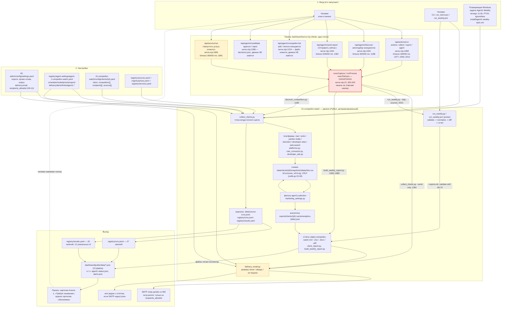

# Аудит встроенности Агента 1 (competitor-watch) в проект

- **Дата:** 2026-11-08
- **Область:** встроенность, контракты, отказоустойчивость, наблюдаемость, стоимость/латентность
- **Метод:** только чтение (read/grep/glob, чтение JSON/YAML/логов). Панель, коллектор, ux-check.mjs,
  verify-data.mjs, движок и планировщик **не запускались**.
- **Все утверждения — с доказательством `путь:строка`.** Пути даны относительно `marketing-agents/`.
- **Сверка с аудитом 2026-11-08:** `audit/agent-layer.md`, `audit/saas-layer.md`, `audit/verification.md`.
  Расхождения зафиксированы отдельно (находки A1-22, A1-23).

---

## 1. Схема потока: вход → настройки → источники → снимок → аналитика → отчёты → доставка → панель/человек

Три независимых входа в один и тот же конвейер (панель, планировщик Windows, CLI) и **три разных
интерпретатора Python** на этих входах (находка A1-10).

### Точки вызова движка из панели (все — синхронные)

| Маршрут | Что запускает | Таймаут | Строка |
|---|---|---|---|
| `POST /api/agent1/discover` | `discover_competitors.py --settings-file ... --json` | 300 000 мс | `dashboard/serve.mjs:1185-1188` |
| `POST /api/agent1/send-report` | `collect_clients.py --client <id> --email-mode on-request --send-only` | 300 000 мс | `dashboard/serve.mjs:1361-1362` |
| `POST /api/service/run` | `build_weekly_report.py --curr <последний снимок>` | 180 000 мс | `dashboard/serve.mjs:1889-1891` |
| `POST /api/actions/run` `action=collect` | `collect.mjs` (коллектор панели, не движок) | 180 000 мс | `dashboard/serve.mjs:1977` |
| `POST /api/actions/run` `action=report` | `build_weekly_report.py` | 180 000 мс | `dashboard/serve.mjs:1991-1993` |
| `POST /api/actions/run` `action=agent` | `run_weekly.py --date <curr> --skip-sources` | 180 000 мс | `dashboard/serve.mjs:2010-2012` |

Панель **не содержит** кнопки, запускающей реальный сбор с площадок: `action=agent` явно идёт с
`--skip-sources` (`dashboard/serve.mjs:2010`) и честно пишет об этом в ответе (`:2017-2019`).
Полный сбор существует только в планировщике и CLI (`install/agent1-weekly.cmd:24`, `scripts/run_client.ps1:54-60`).

### Зависимости и точки отказа

- Один процесс Node, один поток: любая строка из таблицы выше останавливает **все** HTTP-запросы панели,
  т.к. `execFileSync` блокирует event loop (`dashboard/serve.mjs:21`, `:305`, `:319`, `:342-343`).
- `collect.mjs` вызывается в том же процессе (`/api/collect`, `dashboard/serve.mjs:1033-1040`) — тоже блокирует.
- Данные в панель попадают **только** через коллектор (файлы `public/data/*.json`, `dashboard/serve.mjs:849`);
  после ночного прогона планировщика панель сама не обновляется — нужен человек или `/api/collect`
  (`dashboard/public/app-views13.js:21-29`).
- Файлы-«истина» на диске: снимок CSV → аналитика JSON → отчёты → журналы. БД и очереди нет.

---

## 2. Контракты входов/выходов

| # | Артефакт | Формат | Обязательные поля | Где валидация | Что при нарушении |
|---|---|---|---|---|---|
| 1 | `00-admin/config/settings.yaml` | YAML | `thresholds.price_change_pct`, `promo_keywords[]`, `output.formats` (md+xlsx), `delivery.email.smtp_host/smtp_port/smtp_user`, `delivery.recipients_allowlist` | `scripts/cwlib.py:778` (`load_settings`), `scripts/delivery_email.py:92-135` (`email_transport`), `:138-155` (`recipients_allowlist`), `:170-179` (`missing_reason`) | Письмо не уходит, причина словами: «нет SMTP-доступа: … не задан smtp_host» (`delivery_email.py:172-179`). **Пустой/нечитаемый `recipients_allowlist` = ограничений нет** (см. A1-07) |
| 2 | `registry/agent-settings/agent-1-competitor-watch.yaml` | YAML, 9 групп | `schedule.{enabled,days,time}`, `model.*`, `priority.*`, `report.*`, `delivery.{channels,addresses,auto_send}`, `alerts.*`, `limits.*`, `agent1.{watch,selection,analytics,source_modes}` | Панель: `dashboard/serve.mjs:86-179` (`AGENT_SETTINGS_SCHEMA`) + `:1506-1566` (тип/min/max/enum), приёмка `dashboard/verify-data.mjs:189,419-504` | 400 и отказ записи с человеческим текстом (`serve.mjs:1533,1537-1539,1543,1549,1555`); у агента `status: stub` — отказ сохранять (`:1526-1528`). **Движок читает только `agent1.selection`, `agent1.analytics`, `agent1.watch`, `delivery`** — `schedule/model/priority/alerts/limits` не читает никто (A1-03) |
| 3 | `01-competitor-watch/config/clients/<id>.yaml` | YAML v1 | `client`, `competitors[].name`, `sources[].id`, `auth` только `none`, `mode` только `public-pages`, `schedule.weekday/time`, `report.formats` | `scripts/clients.py:72-105` (`validate_client`) | Движок: печатает «ПРОБЛЕМА: …», клиент пропускается целиком (`collect_clients.py:665-668`), exit 1 (`:964`), **запись в `runs.jsonl` не создаётся** (A1-17). Панель при добавлении конкурента: regex id/сайта (`serve.mjs:1228,1262,1264,1276`), контроль отступа и дублей (`:1311-1319`), без источника — предупреждение (`:1332`) |
| 4 | `registry/sources.yaml`, `registry/prices.yaml`, `registry/services.yaml` | YAML | `sources[].id/enabled/status`, `models.*.rub_per_1m_in/out`, `services[].cost_rub/price_rub/enabled` | Читаются как есть: `scripts/sources_tool.py`, `scripts/collect_clients.py:471-474`, `dashboard/serve.mjs:1869-1874` | Отсутствие цены модели → «цена неизвестна» (`dashboard/collector/lib/pricing.mjs:1-5`); выключенная услуга → 400 (`serve.mjs:1871`) |
| 5 | Снимок `data/clients/<id>/snapshots/<date>/lots.csv` | CSV utf-8-sig, CRLF, 18 колонок | Непустые: `snapshot_date, source, competitor, project, lot_id, rooms, area_m2, price_rub, finish, promo_flag, status` (`cwlib.py:33-36`); порядок и полный состав колонок (`:23-28`) | **Только на чтении**: `cwlib.py:383-398` (`validate_header`), `:401-419` (`validate_row`), `:519` (`validate_file`), вызывается лишь из `scripts/snapshot_tool.py:101` | `run_weekly.py:66-70`: `validate != 0` → «validate не прошёл: diff и отчёт не строятся», выход с кодом валидатора. **Писатель снимка (`collect_clients.py:448-453`) свою запись не валидирует** (A1-11) |
| 6 | `reports/clients/<id>/.cache/analytics-<date>.json` | JSON | Схема не описана; обязательных полей в коде нет | Валидации нет (A1-24) | Файла нет → панель показывает «данных нет» (принцип проекта) |
| 7 | Отчёты `<date>-competitor-watch.{md,xlsx,docx,pdf}` + `.eml` | файлы | md и xlsx обязательны (`settings.yaml:69-71`); docx/pdf — по возможностям окружения | Валидации содержимого нет; проблемы собираются в `report["problems"]` (`collect_clients.py:788`) | Прогон **всё равно пишется как `ok`** (`collect_clients.py:785`), exit 0 (A1-09) |
| 8 | `registry/runs.jsonl` | JSONL, append | `run_id, ts, service, client, agent, status, duration_ms, cost_rub, artifact, error` (`collect_clients.py:781-788`); для discover — `kind, sha256_before/after, found` (`scripts/discover_competitors.py:740-744`) | При чтении: `dashboard/collector/lib/agent1-status.mjs:82-87`, `dashboard/collector/lib/service.mjs:39` | Битые строки пропускаются молча, только warning «статус Агента 1 может быть неполным» (`agent1-status.mjs:87`) |
| 9 | `registry/results.yaml` | YAML | `id, title, summary, client, project, period, agent, service, created, artifacts[], sent_channel, sent_to, sent_at, sent_status` (`collect_clients.py:515-532`) | При чтении: `agent1-status.mjs:113-133`. Проверки уникальности `id` нет | Дубли: 20 записей / 12 уникальных id (`res-2026-11-03-svet` ×4) — счётчик «Результатов» завышен (`app-views8.js:338`) (A1-05) |
| 10 | `data/source-runs.jsonl` | JSONL, append, есть межпроцессный lock | `ts, source, status ∈ {ok,partial,blocked,empty}, lots, projects, note` (`log_source_run.py:30-31`) | `log_source_run.py:42-55` (`build_entry`), lock `:58-95`, retries `:96-132` | `ValueError` → exit 1; `OSError` → exit 2 (`:198-206`). Статус формирует движок: `{"ok":"ok","no_data":"empty"}.get(...) or "partial"` (`collect_clients.py:777`) |
| 11 | `data/candidates/<project>.json` + `<project>.decisions.json` | JSON | `summary.{radius_km,in_radius,total}`, `candidates[]`, `limitations[]` | Панель читает и **ничего не выдумывает**: `serve.mjs:1191-1194`; ключ кандидата `id` либо `name \| developer` (`:1429-1433`) | Файл не обновлён → «итога подбора нет, панель кандидатов не выдумывает» (`serve.mjs:1203-1204`); нет файла — 404 «сначала нужен результат поиска от движка» (`:1415`) |
| 12 | `dashboard/public/data/*.json` (22 файла) | JSON | Перечень — `dashboard/serve.mjs:849` | Приёмка: `dashboard/verify-data.mjs` (в т.ч. независимый пересчёт по `runs.jsonl` `:591-604`) | В рантайме валидации нет: панель покажет «данных нет» / пустой раздел |
| 13 | Задача планировщика `install/agent1-weekly-task.xml` | XML (UTF-16) | `Command` = `install/agent1-weekly.cmd`, `WorkingDirectory`, Thursday 11:00, `ExecutionTimeLimit PT2H`, `MultipleInstancesPolicy IgnoreNew` | Никем не валидируется; факт регистрации задачи в Windows — **не предоставлено** | Не проверено |

---

## 3. Находки

Шкала: **P0** — подрывает достоверность/безопасность/управляемость; **P1** — серьёзный операционный
риск; **P2** — заметный, обходимый; **P3** — документация/косметика.

| ID | Область | Находка | Доказательство | Влияние | Sev | Рекомендация | Acceptance criteria |
|---|---|---|---|---|---|---|---|
| A1-01 | Синхронность | Панель полностью заморожена на время любого запуска движка: дочерние процессы идут через `execFileSync`, в одном потоке event loop | `dashboard/serve.mjs:21` (`import { execFileSync }`), `:303-343` (`execCapture`/`runProcess`), вызовы `:1188, :1362, :1891, :1977, :1993, :2012` | При одном прогоне панель не отвечает ни одному пользователю до 180–300 с; второй оператор не увидит даже страницу | **P0** | Пе ревести вызовы движка на асинхронный `spawn` с записью статуса в файл-задание и опросом из UI; ввести очередь на 1 исполнителя | Ручной прогон запускается и `/api/state` отвечает < 1 с в течение всего прогона; журнал задания показывает running/done/failed |
| A1-02 | Стоимость | «Себестоимость факта» в панели — это **смета** `services.yaml`, а не измерение: `cost_rub = svc.cost_rub` пишется в журнал как факт | `dashboard/serve.mjs:1882` (`const cost = Number(svc.cost_rub)`), `:1910` (`cost_rub: proc.ok ? cost : 0`); `registry/services.yaml:13` (`cost_rub: 120`); первые 2 записи `registry/runs.jsonl` — `"cost_rub": 120`, а измеренные прогоны 2026-11-01…11-05 — 0,13…1,27 ₽; подпись в UI: `dashboard/public/app-views8.js:386` («Себестоимость факта … сумма прогонов из журнала»); `dashboard/collector/lib/analytics2.mjs:168` | Маржа и KPI «Себестоимость факта» завышены в ~100 раз и подписаны как факт — нарушение правила проекта «честность данных в интерфейсе» | **P0** | Хранить смету и факт в разных полях (`cost_plan_rub` / `cost_measured_rub`), в UI подписывать «смета», факт брать только из измерений | В `runs.jsonl` нет сметных значений; в UI ни одна цифра не подписана «факт», если источник — `services.yaml` |
| A1-03 | Управляемость | Стоп-кран и расписание из настроек агента **не влияют на фактический запуск**: планировщик вызывает движок напрямую, движок эти поля не читает, при этом UI обещает «немедленно запретить любые запуски» | `install/agent1-weekly.cmd:24` (`collect_clients.py --email-mode always`); grep по `01-competitor-watch/scripts/*.py` по `stop_switch\|schedule.enabled\|min_interval_hours\|skip_weekends\|timeout_sec` → совпадений по существу нет (только `log_source_run.py:96,113` и `search_results.py:466-473` — локальные переменные); `registry/agent-settings/agent-1-competitor-watch.yaml:10-12,50-53`; UI-текст `dashboard/public/app-views12.js:44` («Немедленно запретить любые запуски агента»); схема панели `dashboard/serve.mjs:115` | Автоотправка писем клиентам продолжается при `stop_switch: true` / `schedule.enabled: false`; «стоп-кран» — обещание, которого нет | **P0** | Проверка `limits.stop_switch` и `schedule.enabled` первой строкой в `agent1-weekly.cmd` (и в `run_client.ps1`), либо единый супервизор, читающий agent-settings; в панели — честная подпись, если стоп-кран только «помечает» | Прогон при `stop_switch: true` ничего не собирает и не отправляет, пишет в лог причину; текст в UI соответствует поведению |
| A1-04 | Латентность | Таймаут кнопки не покрывает реальную длительность: 180 000 мс на действия панели против факта 278,7 с на один клиент и 356 с на полный цикл двух клиентов; UI обещает «до минуты» | `dashboard/serve.mjs:1891, :1993, :2012` (180 000), `:1188, :1362` (300 000); `registry/runs.jsonl:27` (`duration_ms: 278747`); `logs/agent1-weekly.log`: 19:14:14 → 19:20:10 (356 с), 03.11 22:42:11 → 22:45:40 (209 с); `dashboard/public/app.js:501` («Это может занять до минуты») | Прогон, уложившийся в реальность, но не в таймаут, убивается (`timedOut`), оставляя частичные файлы и «Письмо НЕ отправлено» (`serve.mjs:1377-1378`) | **P1** | Таймаут считать от измеренной длительности (напр. `PT2H`, как в задаче планировщика) либо вынести запуск в фоновое задание; синхронизировать текст UI | Заявленный в UI и в коде таймаут ≥ p95 фактической длительности из `runs.jsonl`; тест: прогон > 180 с завершается успешно |
| A1-05 | Идемпотентность | Повторный прогон за ту же дату перезаписывает снимок, отчёты, `.eml` и `.cache` и **дописывает** журналы без дедупликации | Снимок: `collect_clients.py:448-453` → `cwlib.py:184-194` (`open(path, "w")`, бэкапа нет); `.eml`/журнал отправки: `delivery_email.py:265-277`; `runs.jsonl`: `collect_clients.py:494-500` (`open(path,"a")`); `results.yaml`: `collect_clients.py:510-533` (`write_atomic(..., backup=True)` без проверки `id`); факт: `registry/results.yaml` — 20 записей, 12 уникальных `id`, `res-2026-11-03-svet` ×4 | Повторный запуск не воспроизводим и не удаляем: снимок за дату уже не восстановить; счётчики «Результатов» и «Прогонов» (`app-views8.js:335,338`) расходятся с числом работ | **P1** | Идемпотентность по ключу `(client_id, date)`: снимок — с `.bak-<timestamp>`; `results.yaml` — upsert по `id`; в UI — «перезапуск за дату» с явным предупреждением | Повторный прогон за ту же дату не увеличивает число записей в `results.yaml` и сохраняет предыдущий снимок |
| A1-06 | Доставка | Факт отправки письма не защищён от дубля: перед отправкой `.cache/email-<date>.json` не читается, кнопка «Отправить сейчас» не имеет ни дедупликации, ни ключа идемпотентности | `collect_clients.py:602-656` (`cmd_send_only` — только проверка режима и наличия отчёта); `delivery_email.py:273-277` (`_write_journal` только пишет); `dashboard/serve.mjs:1361-1362` (нет переданного idempotency-ключа) | Двойной клик или повтор «Отправить сейчас» → клиент получает два письма; в журнале останется только последняя запись | **P1** | Перед отправкой читать `.cache/email-<date>.json` и при `status: sent` за тот же день и тот же набор вложений возвращать «уже отправлено» либо требовать явное подтверждение | Повторный вызов в тот же день не создаёт второй SMTP-сеанс без явного флага `--force`; в ответе панели видно дату и факт предыдущей отправки |
| A1-07 | Безопасность | Белый список получателей **fail-open**: пустой или нечитаемый `recipients_allowlist` снимает ограничения полностью | `delivery_email.py:141-143` («An empty/missing list means "no restriction"»), `:158-161` (`if not allowlist: return list(recipients or []), []`) | Потеря/опечатка в `settings.yaml` → рассылка уйдёт на любой адрес из `agent-settings`/клиентского конфига. Сейчас список заполнен (`settings.yaml:109-111`), т.е. риск латентный | **P1** | Fail-closed: пустой список → отправка запрещена с причиной; флаг `allow_any_recipient` только явно | Пустой `recipients_allowlist` → письмо не уходит, в `.cache/email-*.json` причина «белый список пуст» |
| A1-08 | Достоверность UI | UI называет белым списком адреса агента, а не реальный белый список | `dashboard/public/app-views15.js:586` («Получатели (delivery.addresses, белый список)») против `settings.yaml:109-111` и `delivery_email.py:138-155` | Оператор считает, что адрес из `agent-settings` авторизован, хотя источник ограничения — другой файл | **P1** | Показывать оба списка раздельно: «адреса агента» и «белый список (settings.yaml)», с пересечением | В карточке видны оба источника и явно помечено, какие адреса пройдут фильтр |
| A1-09 | Наблюдаемость | Прогон с отказавшими источниками и непостроенными артефактами помечается как `ok`; панель выносит вердикт «Работа сделана» | `collect_clients.py:785` (`status: "ok" if report["files"] else "error"`), `:822` (`run_client` всегда возвращает `"ok"`), `:964` (exit 0); `logs/agent1-weekly.log`: «ПРЕДУПРЕЖДЕНИЕ: PDF не собран: LibreOffice Kit вернул код 1» + «--- конец, код 0 ---»; `registry/runs.jsonl` — все 27 записей `ok`, при 4 записях с непустым `error`; `agent1-status.mjs:198-201` (`done = lastRun.status === 'ok'`); 401 от `developer-sites` попал в журнал как `empty` (`collect_clients.py:777`), а алерт реагирует только на `registry/sources.yaml` (`alerts.mjs:25`) | Тихая деградация: отчёт без PDF/XLSX и с одним источником из шести выглядит как успех и в журнале, и в панели | **P1** | Вводить `status: partial` по числу отказавших источников и отсутствующим обязательным форматам; вердикт панели — по `partial` тоже не «Работа сделана» | Прогон с отказавшим источником или без обязательного формата не даёт статус `ok` и не даёт зелёный вердикт; в панели видна причина |
| A1-10 | Интеграция | Три разных интерпретатора Python на трёх путях запуска → расходятся зависимости | Панель: `dashboard/serve.mjs:61` (`PYTHON`), `:2012`; планировщик: `install/agent1-weekly.cmd:16-18` (venv `connectors/ru-marketplace-mcp`, иначе `MADIR\.venv`, иначе `py`); CLI: `scripts/run_client.ps1:44-48` (`.dsh\dsh-runtimes\...`); факт расхождения: `registry/runs.jsonl` 2026-11-03 22:34 — `error: "XLSX не собран (нет openpyxl)"`, при том что другие прогоны xlsx построили | Отчёт, собранный одной кнопкой, не воспроизводится другой; дефект зависимостей выглядит как дефект данных | **P1** | Один зафиксированный интерпретатор для всех путей (переменная `CW_PYTHON`) + проверка `openpyxl/docx` на старте с внятной ошибкой | Все три точки запуска используют один и тот же путь к Python, зафиксированный в конфиге; есть preflight-проверка зависимостей |
| A1-11 | Контракты | Писатель снимка не валидирует то, что записал: `validate_file` вызывается только при чтении | `cwlib.py:519` (`validate_file`), единственный вызов — `scripts/snapshot_tool.py:101`; запись без проверки — `collect_clients.py:448-453`; гейт в `run_weekly.py:66-70` | Битый снимок (пустое обязательное поле, чужая дата, неизвестный источник) обнаруживается только при следующем `validate` — в другом сценарии и, возможно, на другой машине | **P1** | Валидировать перед записью в `write_snapshot` и не перезаписывать валидный снимок невалидным | Невалидный снимок не попадает на диск; в логе — причина и код ≠ 0 |
| A1-12 | Интеграция | Кнопка панели «Запустить агента» не собирает данные — это видно в тексте, но оператор может считать данные обновлёнными | `dashboard/serve.mjs:2010` (`--skip-sources`), `:2017-2019` (сообщение); полный сбор — только `install/agent1-weekly.cmd:24` | Разрыв ожиданий: в панели нет ни одной кнопки реального сбора; свежесть данных зависит от планировщика | **P2** | Добавить явную кнопку «Собрать с площадок» (с оговоркой про Chrome) или в карточке показывать «данные от <дата>, собраны планировщиком» | Оператор из панели может инициировать полный сбор либо явно видит, что это невозможно и почему |
| A1-13 | Идемпотентность | Запуск услуги из панели перезаписывает **реальный** клиентский отчёт отчётом, собранным из того же снимка без сбора | `dashboard/serve.mjs:1897-1903` (`artifact = <dir>/<curr>-competitor-watch<ext>`, `fs.copyFileSync`), `:217` (`CLIENT_REPORTS_DIR = CW_DIR/reports/clients`), `CW_DIR = 01-competitor-watch` (`:42`); движок пишет туда же: `collect_clients.py:610-611`, факт в `logs/agent1-weekly.log` | Отчёт движка (с полным набором источников и docx/pdf) затирается пересборкой из снимка; потеря документа для клиента | **P1** | Писать артефакт услуги в отдельный каталог (`reports/service-runs/<run_id>/`) или в имя добавлять источник | Отчёт движка за дату не изменяется после запуска услуги из панели |
| A1-14 | Наблюдаемость | Нет ни одного алерта на провал прогона: правила тревог не смотрят на `runs.jsonl` | `dashboard/collector/lib/alerts.mjs` — правила `source-blocked:27`, `source-empty:35`, `stale-data:52`, `no-snapshots:61`, `tasks-overdue:73`, `spend-spike:92`, `agent-off-tasks:107`, `unknown-prices:119`; журнал прогонов не читается | О падении ночного прогона узнают, только открыв панель; внешнего уведомления нет | **P1** | Тревога «последний прогон не ok / свежего снимка нет к 12:00 четверга» + отправка её на почту оператора | При провале прогона появляется тревога и уведомление, не требующее открытия панели |
| A1-15 | Контракты | Расхождение словаря статусов: движок пишет `error`, панель считает провалом только `failed` | `collect_clients.py:785` (`"error"`), `agent1-status.mjs:91-93` (`failed` — только `status === 'failed'`, остальное в `other`), `dashboard/serve.mjs:1908` (панель пишет `failed`) | Реальные провалы движка не попадают в счётчик «С ошибкой» (`app-views8.js:337`) и не поднимают вердикт | **P2** | Единый словарь статусов (`ok/partial/failed`) с нормализацией при чтении | Оба писателя используют один набор статусов; тест на разбор `error` как провала |
| A1-16 | Трассировка | Нет сквозной трассировки и актора: `run_id` генерируется внутри движка из времени, панель не передаёт correlation id, доступ — один общий ключ | `collect_clients.py:781` (`run_id` из `sha1(client-date-time)`), `dashboard/serve.mjs:1361` (аргументы без id), `:1880` (`runId` из `Date.now()` в панели — своя нумерация), `:726-781` (единый ключ `access.key`, 401 `:1015`) | Нельзя ответить «кто нажал кнопку», «какому прогону принадлежит письмо», «сколько времени прошло от клика до письма» | **P2** | Прокидывать `correlation_id` из панели в движок и в `runs.jsonl`; логировать актора (оператора) | По `correlation_id` из ответа панели находится запись в `runs.jsonl` и запись отправки в `.cache/email-*.json` |
| A1-17 | Отказоустойчивость | Провал клиента не оставляет следа в журнале: при ошибке валидации клиента `runs.jsonl` не пишется, а панель видит предыдущий успешный прогон | `collect_clients.py:659-668` (ранний `return` до записи), запись журнала — только `:781-789`; чтение «последнего» — `agent1-status.mjs:108,164,198-201` | Панель показывает «Работа сделана» по устаревшей записи, хотя сегодняшний прогон провалился | **P1** | Писать запись `status: failed` при любом раннем выходе (включая ошибки валидации клиента) | Каждый запуск (в т.ч. неуспешный) оставляет ровно одну запись в `runs.jsonl` с причиной |
| A1-18 | Отказоустойчивость | Гонка записей реестра: `append_run` идёт без лока, `results.yaml` правится по схеме read-modify-write | `collect_clients.py:494-500` (append без лока), `:510-533` + `sources_tool.py:176-191` (`write_atomic`: temp + `os.replace`, `.tmp-<pid>`); лок есть только у `source-runs.jsonl` (`log_source_run.py:58-132`); защита от параллельных задач — только `MultipleInstancesPolicy IgnoreNew` в `install/agent1-weekly-task.xml` | Планировщик и панель одновременно → потеря записи в `results.yaml`/`runs.jsonl` | **P2** | Распространить файловый лок `log_source_run._acquire_lock` на `results.yaml` и `runs.jsonl` | Параллельные прогоны не теряют записей (тест на 2 процесса) |
| A1-19 | Наблюдаемость | Лог без ротации и со смешанными кодировками в одной строке | `install/agent1-weekly.cmd:23,26` — `>>` (append, только рост); байты `logs/agent1-weekly.log` в одной строке: UTF-8-текст `--- старт …` (`D1 81 D1 82 …`) и CP866-значение пути (`80 E0 E2 A5 AC` = «Артем») начиная со смещения 5830; 13 КБ после двух прогонов | Парсер/мониторинг лога получит «кракозябры» и не найдёт прогон; со временем — неограниченный рост | **P2** | Ротировать лог (по размеру/неделе), писать через Python-обёртку в UTF-8, путь не подставлять в `echo` | Лог всегда валиден как UTF-8, есть ротация и retention |
| A1-20 | Интеграция | «Автоподбор конкурентов» запускается без подтверждения при сохранении поля `query` и блокирует панель на 300 с | `dashboard/public/app-views15.js:156-183` (перехват `POST /api/agent-settings/set`, `setTimeout(..., 250)` → `runAgent1Discover`), `:138-152` (fetch без confirm), `dashboard/serve.mjs:1188` (300 000 мс) | Правка одной строки настроек = синхронный запуск Python на 5 минут, панель недоступна | **P2** | Подтверждение либо фоновое задание с индикатором в карточке | Сохранение поля не блокирует панель; оператор видит прогресс и может отменить |
| A1-21 | Документация | `agent1-weekly.cmd` ссылается на несуществующий установщик | `install/agent1-weekly.cmd:4` («через `install/agent1-weekly-task.ps1`»); на диске только `install/agent1-weekly.cmd`, `install/agent1-weekly-task.xml`, `install/agent1-weekly.cmd.bak-20261104-151806` | Затрудняет воспроизведение настройки на новой машине | **P3** | Исправить ссылку или положить установщик рядом | Комментарий соответствует содержимому каталога |
| A1-22 | Расхождение с аудитом | `audit/saas-layer.md:120` утверждает, что `/api/agent1/send-report` пишет `runs.jsonl`. В коде режим `--send-only` **выходит до любой записи в реестр** | `saas-layer.md:120` против `collect_clients.py:930-934` (`if args.send_only: … return 0`) и `:602-656` (`cmd_send_only` не вызывает `append_run`/`append_result`) | Ошибка в аудите: считается, что у отправки есть след в журнале прогонов, — следа нет (смыкается с A1-16) | **P3** | Исправить `saas-layer.md:120`; добавить запись в журнал или отдельный журнал отправок | Документ соответствует коду; факт отправки ищется в журнале |
| A1-23 | Расхождение с аудитом | Перечень таймаутов панели в аудите неполон/неоднороден: `agent-layer.md:117` упоминает 180 000 только у `:1891`, `saas-layer.md:129` — у `:1993,:2010`; фактически 180 000 стоит ещё у `:1977` и `:2012` | `agent-layer.md:117`, `saas-layer.md:129` против `dashboard/serve.mjs:1891, :1977, :1993, :2012` | Неполный перечень → недооценка зоны блокировки панели | **P3** | Свести все точки в одну таблицу (см. §1 этого отчёта) | Все вызовы `runProcess` перечислены с таймаутами |
| A1-24 | Контракты | Для аналитического JSON (`.cache/analytics-<date>.json`) контракт не описан и не валидируется: обязательных полей нет ни в коде, ни в схеме | Файлы есть (`reports/clients/client-svet/.cache/analytics-2026-11-05.json`, 28 221 байт), потребитель — панель и `client_report.py`; поиск валидатора/схемы не дал совпадений | Изменение формата аналитики не сломает валидацию — сломает отчёт или панель молча | **P2** | Зафиксировать схему `analytics/v1` (json-schema в `scripts/SCHEMA.md`) и валидировать при записи | Схема опубликована; запись невалидного JSON невозможна |

### Что уже было в аудите 2026-11-08 (не дублирую как новое)

- **A1-01** — `saas-layer.md:18,506,528`.
- **Синхронные 180–300 с** — `saas-layer.md:206,267,525-531`; `agent-layer.md:117`.
- **A1-02 / A1-04 (частично)** — `saas-layer.md:20,320-321`; `agent-layer.md:56,316` (там значится `[НЕ ХВАТАЕТ ДАННЫХ]`).
  Здесь добавлена проверенная формула и явное доказательство, что «факт» берётся из `services.yaml`.
- **A1-07 (как риск)** — `saas-layer.md:513`.
- **A1-09 (деградация без ошибки)** — `agent-layer.md:206` (`[F7] LibreOffice != 0 => отчёт без pdf, прогон продолжается`).
- **Настройки-«декорация»** — `agent-layer.md:21,47-60`, `audit/verification.md:18`; я перепроверил grep'ом (см. A1-03):
  подтверждается, добавлен вывод про планировщик (в аудите его нет).

---

## 4. Scorecard

| Критерий | Оценка | Обоснование (факты) |
|---|---|---|
| **Интеграция / контракты** | **3 / 5** | Контракты есть и описаны: `AGENT_SETTINGS_SCHEMA` (`dashboard/serve.mjs:86-179`), 18 колонок снимка (`scripts/cwlib.py:23-38`), документированные записи журналов (`collect_clients.py:781-788`, `log_source_run.py:30-31`), панель не выдумывает данные (`serve.mjs:1191-1204`). Минусы: три интерпретатора Python (A1-10), две схемы записей `runs.jsonl`, расхождение словаря статусов (A1-15), валидация снимка только на чтении (A1-11), нет схемы аналитики (A1-24) |
| **Отказоустойчивость** | **2 / 5** | Плюсы: `--dry-run`, атомарные правки с `.bak`, лок и 12 ретраев у `source-runs.jsonl` (`log_source_run.py:58-132`), честный fallback `.eml` при отсутствии SMTP (`delivery_email.py:22-25,310-317`), гейт `validate` перед отчётом (`run_weekly.py:66-70`), `IgnoreNew` + `PT2H` в задаче. Минусы: провал клиента не журналируется (A1-17), частичный отказ = `ok` (A1-09), нет идемпотентности (A1-05), нет защиты от дубля письма (A1-06), fail-open allowlist (A1-07), гонки реестра (A1-18). `priority.retries: 2` объявлено (`agent-settings...yaml:27`), но не читается никем |
| **Наблюдаемость** | **2 / 5** | Плюсы: `runs.jsonl` (27 записей с `duration_ms`, `error`), `source-runs.jsonl` со статусами источников, `logs/agent1-weekly.log`, статус-документ Агента 1 с доказательствами (`agent1-status.mjs:168-215`), независимый пересчёт в приёмке (`verify-data.mjs:591-604`). Минусы: нет трассировки и актора (A1-16), нет алерта на провал прогона (A1-14), вердикт «Работа сделана» при деградации (A1-09), статус `error` теряется (A1-15), тревоги видны только при открытой панели (A1-14), лог без ротации и со смешанной кодировкой (A1-19) |
| **Стоимость / латентность** | **1 / 5** | ₽ — оценка, а не факт: `tokens = символы / 4` × прайс `prices.yaml` (`collect_clients.py:468-480`), при этом LLM в конвейере не вызывается вообще (grep по `01-competitor-watch/scripts/*.py`: только `web_search.py:129-214` — HTTP-поиск, никаких `chat/completions`); разброс 0,13…1,27 ₽ на прогонах одного размера и 120 ₽ в первых записях (`registry/runs.jsonl`); панель подписывает сметное значение как «Себестоимость факта» (A1-02). Латентность: 278,7 с на клиента и 356 с на цикл против таймаутов 180/300 с; панель на это время мертва (A1-01, A1-04) |
| **Итого** | **2,0 / 5** | Ядро считает и отчитывается честно и воспроизводимо, но интеграционный слой (панель ↔ движок ↔ планировщик) не выдерживает ни параллельного пользователя, ни отказа источника, а «себестоимость» в интерфейсе подменяет факт сметой |

---

## 5. Не предоставлено / запросить

| # | Что не предоставлено | Почему важно | Что запросить |
|---|---|---|---|
| 1 | Факт регистрации задачи `Agent1-Weekly` в Планировщике Windows (`schtasks /Query /TN Agent1-Weekly /V /FO LIST`): состояние, `Last Run Time`, `Last Result`, следующий запуск | В репозитории только XML (`install/agent1-weekly-task.xml`); подтверждения, что задача реально создана и отработала, нет. Ни один прогон 04–05.11 не совпадает с четвергом 11:00 — все запускались вручную | Вывод `schtasks /Query` + скриншот «Журнала задач» |
| 2 | Фактическое значение и наличие SMTP-пароля (`DSH_SMTP_PASSWORD` / `00-admin/config/.smtp-password.local`) на машине, где идёт прогон | `delivery_email.py:121-135,170-179`: без пароля письмо сохраняется как `.eml` со статусом «не отправлено»; секрет вне репозитория | Подтверждение «переменная задана» без раскрытия значения (или результат тестового прогона) |
| 3 | Журнал отправок на стороне SMTP (Яндекс 360): принято/отклонено, по каким адресам, дубли | Проверить A1-06 (дубли) и факт доставки можно только по стороне сервера | Выгрузка лога SMTP за 03–05.11.2026 |
| 4 | Распределение длительности прогонов (p50/p95) по `runs.jsonl` и по клиентам при штатной нагрузке | Обосновать новый таймаут панели (A1-04) и SLA | ≥ 10 полных прогонов (или расчёт по существующим 27 записям с разметкой «сбор/без сбора») |
| 5 | Схема/спека аналитического JSON `.cache/analytics-<date>.json` и `data/candidates/<project>.json` | Нет контракта → нет валидации (A1-24, §2 п.6, 11) | Схема `analytics/v1` и `candidates/v1` (или решение зафиксировать их в `scripts/SCHEMA.md`) |
| 6 | Ожидаемое число клиентов и целевая пропускная способность панели (сколько операторов одновременно) | Без этого нельзя выбрать между «очередью» и «фоновым заданием» (A1-01) | Ответ заказчика: N клиентов, N операторов, допустимое время устаревания панели |
| 7 | Правило расчёта себестоимости, согласованное заказчиком (что считать фактом при детерминированном конвейере) | A1-02/A1-04: в системе две цифры (120 ₽ и ~1 ₽), и ни одна не является измерением | Решение Lead: либо убрать ₽ из прогонов Агента 1, либо ввести измерение (например, стоимость внешних API-вызовов) |
| 8 | Данные о 401/captcha за период: сколько прогонов потеряло источники, сколько раз был `no_data` по 401 | Оценить реальный масштаб A1-09 (`developer-sites` 401 в `logs/agent1-weekly.log`) | Выгрузка `data/source-runs.jsonl` за 2 недели + пояснение, ожидает ли движок авторизации у этих площадок |
| 9 | Подтверждение, что `registry/sources.yaml` (ручной реестр статусов) синхронизирован с фактическими исходами прогонов | `alerts.mjs:25` поднимает `critical` только по ручному полю `status: blocked`, а не по факту 401 | Сверка: статусы в `registry/sources.yaml` против `data/source-runs.jsonl` |
| 10 | Кто владелец логов и политика хранения (`logs/agent1-weekly.log`, `runs.jsonl`, `results.yaml`, `.bak-*`) | `results.yaml.bak-*` уже десятки файлов; роста лога ничто не ограничивает (A1-19) | Решение: срок хранения, ротация, кто чистит |
