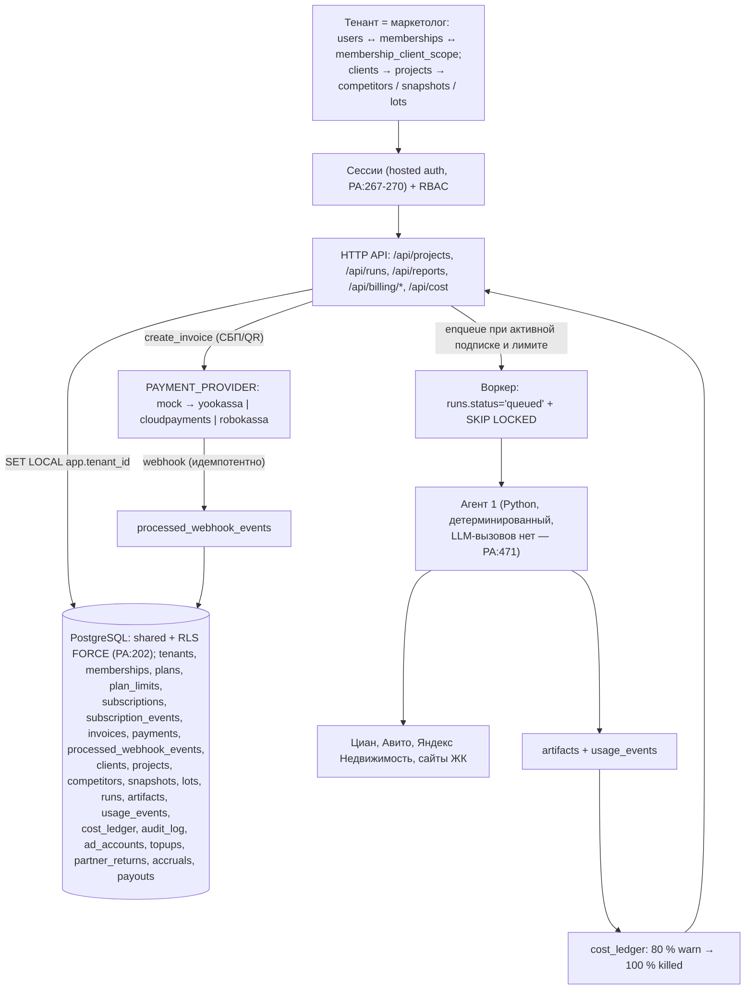

# Мультитенантный SaaS: сверка с утверждённой архитектурой и восполнение пробелов до внедрения

Задача: shared task `task-2` (в редакции Lead от 08.11.2026). Автор: teammate `target-arch`, 2026-11-08.
Метод: только чтение (`read`/`grep`/`glob`), ничего не запускалось. Ссылки — `путь:строка` от корня
`C:\Users\Артем\Desktop\тестDH`. Гипотезы помечены; «нет данных» — данных нет.

**Статус.** Целевая архитектура утверждена: `docs/strategy-2026-11-08/platform-architecture.md` (`PA`) и план
`docs/strategy-2026-11-08/roadmap-2-sprints.md` (`RM`). Файл не альтернатива: (1) сверка утверждённого с фактами кода,
(2) то, чего в пакете нет — исполнимый PostgreSQL DDL с `tenant_id`/RLS, схема идемпотентности webhook,
`usage_events`/`cost_ledger`, overage-лимиты, (3) пробелы и расхождения (§8). Проверено: во всём
`docs/strategy-2026-11-08/**` нет ни `CREATE TABLE`, ни `CREATE POLICY` (grep — 0): описания таблиц `PA:249-253,366-372`
не доведены до миграций.

## 1. Модель изоляции: сверка

Утверждено (`PA:189-204`): `tenant_id` в каждой таблице + RLS; shared — до ~20 клиентов, schema-per-tenant — 20–100,
cluster-per-tenant — ≥1000; пути `tenant/<tenant_id>/...` (`PA:255`). **Расхождений с фактами нет:** понятия «тенант»
в коде нет (единственная проверка — ключ, `dashboard/serve.mjs:1014`; `client_id` из тела запроса без проверки прав,
`dashboard/serve.mjs:1865-1874`); «схлопывание» лота подтверждается (`dashboard/serve.mjs:44`; ключ лота без тенанта —
`audit/saas-layer.md:240-243`); ролей и сессий нет (`audit/saas-layer.md:154`); иерархия «ПЛАТФОРМА → ОПЕРАТОР →
КЛИЕНТ» объявлена (`registry/operators.yaml:3-6`; `operator_id` — `registry/clients.yaml:9,22,31,42`), но не исполняется.

**Сейчас:** одна БД; `tenants` = маркетолог → `clients` → `projects` → `ad_accounts` (`PA:231-235`); RLS `FORCE`; роли
`app_tenant`/`app_admin`; `memberships.role ∈ {owner, manager, client_viewer}` (`PA:240`). **Откладываем:**
schema-per-tenant, кластеры на тенанта, `client_scope` для `client_viewer` («таблицы не переделываются» — `PA:256`),
векторный поиск (`PA:292`).

**Гипотеза/расхождение.** `PA:256` добавляет `client_scope` позже «без переделки таблиц», но `client_id` нужен в
tenant-таблицах уже в первой миграции: иначе второй проход по схеме и окно для записей без `tenant_id` (ранний сигнал
риска из `PA:503`). Дешевле проставить `client_id` NOT NULL там, где данные принадлежат клиенту маркетолога
(`projects`, `snapshots`, `lots`, `runs`, `artifacts`, `ad_accounts`) и завести пустую политику scope сразу.

## 2. PostgreSQL DDL: `tenant_id`, RLS, ключи идемпотентности

Восполнение пробела (SQL в пакете нет). Колонки — по `PA:249-253,366-372` и ключам метеринга `PA:328-334`.

```sql
CREATE EXTENSION IF NOT EXISTS pgcrypto;
-- тенант и доступ (PA:240)
CREATE TABLE tenants (id uuid PRIMARY KEY DEFAULT gen_random_uuid(), name text NOT NULL, kind text NOT NULL DEFAULT 'marketer' CHECK (kind IN ('marketer','platform')), state text NOT NULL DEFAULT 'registered' CHECK (state IN ('registered','trial','active','past_due','frozen','churned')), trial_started_at timestamptz, first_report_at timestamptz, created_at timestamptz NOT NULL DEFAULT now());
CREATE TABLE users (id uuid PRIMARY KEY DEFAULT gen_random_uuid(), email citext NOT NULL UNIQUE, created_at timestamptz NOT NULL DEFAULT now());
CREATE TABLE memberships (id uuid PRIMARY KEY DEFAULT gen_random_uuid(), tenant_id uuid NOT NULL REFERENCES tenants(id) ON DELETE CASCADE, user_id uuid NOT NULL REFERENCES users(id), role text NOT NULL CHECK (role IN ('owner','manager','client_viewer')), status text NOT NULL DEFAULT 'invited' CHECK (status IN ('invited','active','revoked')), UNIQUE (tenant_id, user_id));
CREATE TABLE membership_client_scope (membership_id uuid REFERENCES memberships(id) ON DELETE CASCADE, client_id uuid NOT NULL, PRIMARY KEY (membership_id, client_id));  -- отложенная роль (PA:256)
-- клиенты, проекты, данные сбора (PA:251)
CREATE TABLE clients (id uuid PRIMARY KEY DEFAULT gen_random_uuid(), tenant_id uuid NOT NULL REFERENCES tenants(id) ON DELETE CASCADE, name text NOT NULL, contact_hash text, status text NOT NULL DEFAULT 'active' CHECK (status IN ('lead','active','paused','churned')), UNIQUE (tenant_id, name));
CREATE TABLE projects (id uuid PRIMARY KEY DEFAULT gen_random_uuid(), tenant_id uuid NOT NULL REFERENCES tenants(id) ON DELETE CASCADE, client_id uuid NOT NULL REFERENCES clients(id), code text NOT NULL, name text NOT NULL, UNIQUE (tenant_id, client_id, code));
CREATE TABLE competitors (id uuid PRIMARY KEY DEFAULT gen_random_uuid(), tenant_id uuid NOT NULL REFERENCES tenants(id) ON DELETE CASCADE, project_id uuid NOT NULL REFERENCES projects(id), name text NOT NULL, domain text, sources text[] NOT NULL DEFAULT '{}', enabled boolean NOT NULL DEFAULT true, UNIQUE (tenant_id, project_id, name));
CREATE TABLE snapshots (id uuid PRIMARY KEY DEFAULT gen_random_uuid(), tenant_id uuid NOT NULL REFERENCES tenants(id) ON DELETE CASCADE, project_id uuid NOT NULL REFERENCES projects(id), snapshot_date date NOT NULL, rows_count integer NOT NULL DEFAULT 0, source_path text, checksum text, UNIQUE (tenant_id, project_id, snapshot_date));
CREATE TABLE lots (id bigserial PRIMARY KEY, tenant_id uuid NOT NULL REFERENCES tenants(id) ON DELETE CASCADE, snapshot_id uuid NOT NULL REFERENCES snapshots(id) ON DELETE CASCADE, source text NOT NULL, competitor text NOT NULL, project text NOT NULL, lot_id text NOT NULL, rooms text, area_m2 numeric(8,2), price_rub bigint, price_per_m2 numeric(12,2), finish text, delivery text, promo_flag boolean NOT NULL DEFAULT false, status text, url text,
  UNIQUE (tenant_id, snapshot_id, source, competitor, project, lot_id));   -- tenant_id снимает «схлопывание» (PA:194-196)
-- прогоны, артефакты, метеринг (PA:253,328-334)
CREATE TABLE runs (id uuid PRIMARY KEY DEFAULT gen_random_uuid(), tenant_id uuid NOT NULL REFERENCES tenants(id) ON DELETE CASCADE, client_id uuid NOT NULL REFERENCES clients(id), project_id uuid REFERENCES projects(id) ON DELETE SET NULL, agent_id text NOT NULL, service text NOT NULL, run_key text NOT NULL, status text NOT NULL DEFAULT 'queued' CHECK (status IN ('queued','running','ok','partial','failed','killed','needs_review')), started_at timestamptz NOT NULL DEFAULT now(), finished_at timestamptz, duration_ms integer, cost_rub numeric(12,4) NOT NULL DEFAULT 0, error text, UNIQUE (tenant_id, agent_id, run_key));   -- ключ прогона — PA:332
CREATE INDEX runs_queue_idx ON runs (status, started_at) WHERE status = 'queued';   -- очередь без Kafka
CREATE TABLE artifacts (id uuid PRIMARY KEY DEFAULT gen_random_uuid(), tenant_id uuid NOT NULL REFERENCES tenants(id) ON DELETE CASCADE, run_id uuid REFERENCES runs(id) ON DELETE SET NULL, client_id uuid REFERENCES clients(id) ON DELETE SET NULL, kind text NOT NULL CHECK (kind IN ('report','snapshot','raw')), format text NOT NULL, template_version text NOT NULL DEFAULT 'v1', storage_path text NOT NULL, bytes bigint, checksum text, sent_status text NOT NULL DEFAULT 'not_sent' CHECK (sent_status IN ('not_sent','queued','sent','failed')), UNIQUE (run_id, format, template_version));   -- ключ отчёта — PA:333
CREATE TABLE usage_events (id bigserial PRIMARY KEY, tenant_id uuid NOT NULL REFERENCES tenants(id) ON DELETE CASCADE, run_id uuid REFERENCES runs(id) ON DELETE CASCADE, step_id text, kind text NOT NULL CHECK (kind IN ('llm_call','source_page','run','report','delivery')), provider_request_id text, url_hash text, recipient_hash text, model text, tokens_in bigint NOT NULL DEFAULT 0, tokens_out bigint NOT NULL DEFAULT 0, tokens_cache_read bigint NOT NULL DEFAULT 0, quantity numeric(14,3) NOT NULL DEFAULT 0, unit text NOT NULL, idempotency_key text NOT NULL UNIQUE, occurred_at timestamptz NOT NULL DEFAULT now(), meta jsonb NOT NULL DEFAULT '{}');
-- idempotency_key = склейка по виду (PA:168,328-334): (run_id,step_id,provider_request_id) | (run_id,step_id,url_hash) |
-- (run_id,format,template_version) | (run_id,recipient_hash,template_version) | (tenant_id,agent_id,run_key)
CREATE INDEX usage_events_tenant_time_idx ON usage_events (tenant_id, occurred_at DESC);
CREATE TABLE cost_ledger (id bigserial PRIMARY KEY, tenant_id uuid NOT NULL REFERENCES tenants(id) ON DELETE CASCADE, run_id uuid REFERENCES runs(id) ON DELETE SET NULL, usage_event_id bigint REFERENCES usage_events(id) ON DELETE SET NULL, layer text NOT NULL CHECK (layer IN ('prompt','tool','memory','response','none')), metric text NOT NULL CHECK (metric IN ('llm_token','work_unit','external_api')), quantity numeric(14,3) NOT NULL, unit_cost_rub numeric(12,6) NOT NULL, amount_rub numeric(12,4) NOT NULL, model text, occurred_at timestamptz NOT NULL DEFAULT now(), meta jsonb NOT NULL DEFAULT '{}', UNIQUE (usage_event_id, layer));
CREATE INDEX cost_ledger_tenant_time_idx ON cost_ledger (tenant_id, occurred_at DESC);
-- биллинг (PA:340-354, RM:120)
CREATE TABLE plans (code text PRIMARY KEY CHECK (code IN ('starter','growth','pro','enterprise')), name text NOT NULL, price_rub_month integer NOT NULL, projects_max integer, seats_max integer, in_first_wave boolean NOT NULL DEFAULT true, cashback_share numeric(4,3) NOT NULL DEFAULT 0 CHECK (cashback_share BETWEEN 0 AND 1));
CREATE TABLE plan_limits (plan_code text NOT NULL REFERENCES plans(code) ON DELETE CASCADE, metric text NOT NULL CHECK (metric IN ('projects','runs_day','runs_month','work_units','llm_budget_rub','seats')), included_qty numeric(14,3) NOT NULL, warn_pct integer NOT NULL DEFAULT 80, overage_price_rub numeric(12,4), overage_requires_consent boolean NOT NULL DEFAULT true, on_limit text NOT NULL DEFAULT 'killed' CHECK (on_limit IN ('warn','pause','killed')), PRIMARY KEY (plan_code, metric));
CREATE TABLE subscriptions (id uuid PRIMARY KEY DEFAULT gen_random_uuid(), tenant_id uuid NOT NULL REFERENCES tenants(id) ON DELETE CASCADE, plan_code text NOT NULL REFERENCES plans(code), state text NOT NULL DEFAULT 'trial' CHECK (state IN ('registered','trial','active','past_due','frozen','churned')), period_start date NOT NULL, period_end date NOT NULL, price_rub integer NOT NULL, grace_until timestamptz, provider text, provider_subscription_ref text, created_at timestamptz NOT NULL DEFAULT now(), UNIQUE (tenant_id, period_start));
CREATE TABLE subscription_events (id uuid PRIMARY KEY DEFAULT gen_random_uuid(), tenant_id uuid NOT NULL REFERENCES tenants(id) ON DELETE CASCADE, subscription_id uuid NOT NULL REFERENCES subscriptions(id) ON DELETE CASCADE, kind text NOT NULL, expected_state text, new_state text NOT NULL, actor text NOT NULL DEFAULT 'system', idempotency_key text NOT NULL UNIQUE, at timestamptz NOT NULL DEFAULT now());   -- CAS + идемпотентность (PA:429-430)
CREATE TABLE invoices (id uuid PRIMARY KEY DEFAULT gen_random_uuid(), tenant_id uuid NOT NULL REFERENCES tenants(id) ON DELETE CASCADE, subscription_id uuid REFERENCES subscriptions(id) ON DELETE SET NULL, period text NOT NULL, amount_rub integer NOT NULL, tax_rub integer NOT NULL DEFAULT 0, status text NOT NULL CHECK (status IN ('draft','issued','paid','void','refunded')), provider_invoice_id text, pay_url text, issued_at timestamptz, paid_at timestamptz, UNIQUE (tenant_id, period));
CREATE TABLE payments (id uuid PRIMARY KEY DEFAULT gen_random_uuid(), tenant_id uuid NOT NULL REFERENCES tenants(id) ON DELETE CASCADE, invoice_id uuid REFERENCES invoices(id) ON DELETE SET NULL, provider text NOT NULL, provider_payment_id text NOT NULL, amount_rub integer NOT NULL, acquiring_fee_rub integer NOT NULL DEFAULT 0,   -- эквайринг 2,5–3 % (concept:97)
  status text NOT NULL CHECK (status IN ('pending','succeeded','canceled','refunded')), idempotency_key text NOT NULL, paid_at timestamptz, created_at timestamptz NOT NULL DEFAULT now(), UNIQUE (provider, provider_payment_id), UNIQUE (tenant_id, idempotency_key));
CREATE TABLE processed_webhook_events (provider text NOT NULL, event_id text NOT NULL, event_type text NOT NULL, payload jsonb NOT NULL, attempts integer NOT NULL DEFAULT 0, last_error text, received_at timestamptz NOT NULL DEFAULT now(), processed_at timestamptz, PRIMARY KEY (provider, event_id));
CREATE TABLE audit_log (id bigserial PRIMARY KEY, tenant_id uuid REFERENCES tenants(id) ON DELETE SET NULL, actor text NOT NULL, action text NOT NULL, entity text, entity_id text, request_id text, ip inet, at timestamptz NOT NULL DEFAULT now(), details jsonb NOT NULL DEFAULT '{}');
-- кэшбэк-контур (PA:366-372): pass-through, отдельно от usage-биллинга
CREATE TABLE ad_accounts (id uuid PRIMARY KEY DEFAULT gen_random_uuid(), tenant_id uuid NOT NULL REFERENCES tenants(id) ON DELETE CASCADE, client_id uuid NOT NULL REFERENCES clients(id), platform text NOT NULL, external_id text NOT NULL, partner text CHECK (partner IN ('elama','vitamin','direct')), credential_ref text, status text NOT NULL DEFAULT 'active', UNIQUE (tenant_id, platform, external_id));
CREATE TABLE topups (id uuid PRIMARY KEY DEFAULT gen_random_uuid(), tenant_id uuid NOT NULL REFERENCES tenants(id), ad_account_id uuid NOT NULL REFERENCES ad_accounts(id), partner text, amount_rub numeric(14,2) NOT NULL, paid_at date, confirmed_at date, doc text);
CREATE TABLE partner_returns (id uuid PRIMARY KEY DEFAULT gen_random_uuid(), tenant_id uuid NOT NULL REFERENCES tenants(id), ad_account_id uuid NOT NULL REFERENCES ad_accounts(id), period text NOT NULL, gross_return_rub numeric(14,2) NOT NULL, commission_pct numeric(4,2) NOT NULL DEFAULT 3, net_return_rub numeric(14,2) NOT NULL, cash_in_at date, UNIQUE (ad_account_id, period));   -- комиссия партнёра 3 % (PA:374)
CREATE TABLE accruals (id uuid PRIMARY KEY DEFAULT gen_random_uuid(), tenant_id uuid NOT NULL REFERENCES tenants(id), ad_account_id uuid NOT NULL REFERENCES ad_accounts(id), partner_return_id uuid NOT NULL REFERENCES partner_returns(id), period text NOT NULL, share_pct numeric(4,3) NOT NULL, amount_rub numeric(14,2) NOT NULL CHECK (amount_rub >= 0), status text NOT NULL DEFAULT 'pending' CHECK (status IN ('pending','confirmed','paid','blocked')), idempotency_key text NOT NULL UNIQUE, UNIQUE (ad_account_id, period, partner_return_id));   -- PA:381
CREATE TABLE payouts (id uuid PRIMARY KEY DEFAULT gen_random_uuid(), tenant_id uuid NOT NULL REFERENCES tenants(id), amount_rub numeric(14,2) NOT NULL, subscription_credit_rub numeric(14,2) NOT NULL DEFAULT 0, withdrawal_rub numeric(14,2) NOT NULL DEFAULT 0, method text, status text NOT NULL DEFAULT 'pending', doc text);
```

### 2.1 RLS

```sql
CREATE ROLE app_tenant NOLOGIN;            -- приложение арендатора
CREATE ROLE app_admin LOGIN BYPASSRLS;     -- миграции, биллинг, sweeper
GRANT SELECT, INSERT, UPDATE, DELETE ON ALL TABLES IN SCHEMA public TO app_tenant;
DO $$ DECLARE t text; BEGIN
  FOREACH t IN ARRAY ARRAY['clients','projects','competitors','snapshots','lots','runs','artifacts','usage_events','cost_ledger','subscriptions','subscription_events','invoices','payments','memberships','ad_accounts','topups','partner_returns','accruals','payouts'] LOOP
    EXECUTE format('ALTER TABLE %I ENABLE ROW LEVEL SECURITY', t);
    EXECUTE format('ALTER TABLE %I FORCE ROW LEVEL SECURITY', t);      -- и для владельца таблицы
    EXECUTE format($f$CREATE POLICY %I ON %I USING (tenant_id = current_setting('app.tenant_id', true)::uuid) WITH CHECK (tenant_id = current_setting('app.tenant_id', true)::uuid)$f$, t || '_tenant_isolation', t);
  END LOOP; END $$;
ALTER TABLE plans ENABLE ROW LEVEL SECURITY;         -- справочники: читают все, пишет app_admin
CREATE POLICY plans_read ON plans FOR SELECT USING (true);
ALTER TABLE plan_limits ENABLE ROW LEVEL SECURITY;
CREATE POLICY plan_limits_read ON plan_limits FOR SELECT USING (true);
-- отложенный scope «клиента маркетолога» (PA:256,503)
CREATE POLICY lots_client_scope ON lots AS RESTRICTIVE FOR SELECT USING (coalesce(current_setting('app.client_scope', true), '') = '' OR project_id IN (SELECT p.id FROM projects p WHERE p.client_id::text = any(string_to_array(current_setting('app.client_scope', true), ','))));
```

Паттерн запроса (в одной транзакции; без `SET LOCAL` политика вернёт 0 строк — это fail-closed):

```sql
BEGIN;
SET LOCAL app.tenant_id = '3f1a7c2e-9b04-4c1d-8a55-0d6e2f7b1c33';
SELECT id, state, cost_rub FROM runs ORDER BY started_at DESC LIMIT 20;
COMMIT;
```

### 2.2 Предохранитель `Σ accrual ≤ net_return`: в `PA` неисполнимо

`PA:375` требует «`Σ accrual ≤ net_return` в той же транзакции (deferred CHECK)». В PostgreSQL `CHECK` **не допускает
подзапрос** — не компилируется. Исполнимая замена:

```sql
CREATE FUNCTION accrual_le_net_return() RETURNS trigger LANGUAGE plpgsql AS $$
DECLARE net numeric; acc numeric;
BEGIN
  SELECT net_return_rub INTO net FROM partner_returns WHERE id = NEW.partner_return_id;
  SELECT coalesce(sum(amount_rub),0) INTO acc FROM accruals WHERE partner_return_id = NEW.partner_return_id;
  IF acc > net THEN RAISE EXCEPTION 'accruals % > net_return %', acc, net; END IF; RETURN NULL; END $$;
CREATE CONSTRAINT TRIGGER accrual_guard AFTER INSERT OR UPDATE ON accruals
  DEFERRABLE INITIALLY DEFERRED FOR EACH ROW EXECUTE FUNCTION accrual_le_net_return();
```

## 3. Биллинг и webhooks

**Жизненный цикл — утверждённый (`PA:409-432`):** `registered → trial → active → past_due → frozen → churned`; триал
72 ч от `trial_start` (`PA:412,425`); `past_due` — grace 7 дней с полным доступом (`PA:418`); ретраи D+1/D+3/D+7
(`PA:353`); `frozen` останавливает прогоны, экспорт и доставку (`PA:424`); retention 90 дней (`PA:428`); каждый переход —
`subscription_events` с CAS по `expected_state` (`PA:429-430`).

**Webhook (схемы в `PA` нет — восполняем §2):** `POST /api/billing/webhook`, идемпотентность по PK
`(provider, event_id)`, обработка в одной транзакции с платежом. События: `payment.succeeded` (платёж `succeeded`, счёт
`paid`, `trial|past_due → active`), `payment.canceled` (→ dunning), `refund.succeeded` (`refunded` + запись в `audit_log`),
`subscription.canceled` (→ `cancel_at`).

```python
# marketing-agents/billing/webhook.py  (гипотеза: новый модуль этапа 2, RM:121)
CLAIM = """INSERT INTO processed_webhook_events (provider, event_id, event_type, payload) VALUES (%s,%s,%s,%s::jsonb)
           ON CONFLICT (provider, event_id) DO NOTHING RETURNING event_id"""
def handle(conn, provider: str, ev: dict) -> bool:
    with conn.transaction():
        if not conn.execute(CLAIM, (provider, ev["id"], ev["type"], json.dumps(ev))).fetchone():
            return True                        # повтор доставки: 200 и ничего не дублируем
        apply_event(conn, provider, ev)        # UPDATE payments/invoices/subscriptions; CAS по expected_state
        conn.execute("UPDATE processed_webhook_events SET processed_at=now() WHERE provider=%s AND event_id=%s", (provider, ev["id"]))
        conn.execute("INSERT INTO audit_log (tenant_id, actor, action, entity, details) VALUES (%s,'system',%s,'payment',%s)", (ev["tenant_id"], ev["type"], json.dumps(ev)))
    return True
```

```python
# marketing-agents/billing/payment_provider.py  (гипотеза: новый модуль)
class MockProvider:                        # сценарии биллинга без сети и договора
    name = "mock"
    def verify_signature(self, headers, body: bytes) -> bool: return True
    def create_invoice(self, *, tenant_id, amount_rub, idempotency_key):   # СБП/QR — заглушка (PA:349-351)
        return {"provider_invoice_id": f"mock-{idempotency_key}", "status": "pending",
                "pay_url": f"https://mock.local/pay/{idempotency_key}"}
    def parse_webhook(self, headers, body: bytes) -> dict:
        e = json.loads(body)
        return {"id": e["event_id"], "type": e["type"], "tenant_id": e["tenant_id"],
                "payment": {"provider_payment_id": e["payment_id"], "amount_rub": e["amount_rub"]}}
PROVIDERS = {"mock": MockProvider()}       # yookassa | cloudpayments | robokassa — после выбора шлюза
def get_provider(): return PROVIDERS[os.environ.get("PAYMENT_PROVIDER", "mock")]
```

**Шлюз не выбран — данных нет.** В каталоге: ЮKassa (карта, СБП), CloudPayments, Robokassa, Т-Банк
(`docs/integrations-catalog.md:66-69`); `Stripe` в каталоге не значится (в `task-2` назван — беру перечень каталога).
Чек/ККТ через провайдера — обязательство этапа 2 (`RM:121`); ККТ и РКН не закрыты (`docs/strategy-2026-11-08/README.md:31`).

```dotenv
PAYMENT_PROVIDER=mock             # каталог: yookassa | cloudpayments | robokassa (integrations-catalog.md:66-69)
PAYMENT_WEBHOOK_SECRET=<секрет>    # секреты вне репозитория (PA:216-219)
ACQUIRING_FEE_PCT=3.0              # эквайринг 2,5–3 % (concept-saas-2026-11-04.md:97)
DUNNING_OFFSETS_DAYS=1,3,7         # PA:353
GRACE_DAYS=7                       # PA:418
TRIAL_HOURS=72                     # PA:412
LLM_BUDGET_RUB_MONTH=3000          # объявлен, но не читается (PA:275-276; agent-settings:19-21)
```

**Лимиты и overage** (`PA:346-347`): лимит проектов проверяется **до** создания сущности; 80 % — предупреждение
(`plan_limits.warn_pct`), 100 % — hard-stop `killed`; overage — только по явному согласию. Известные числа: Starter
1 проект / 5 000 ₽, Growth до 3 / 15 000 ₽, Pro до 10 / 30 000 ₽ (`README.md:59-60`). Цена превышения, seats-лимиты
и бюджет прогонов — «нет данных».

## 4. Учёт стоимости: `usage_events` → `cost_ledger`

**Факт, определяющий модель:** у Агента 1 LLM-вызовов нет (движок детерминированный, `audit/saas-layer.md:304-308`), а
себестоимость считается как `символы/4`, где выход — размер файлов отчёта
(`01-competitor-watch/scripts/collect_clients.py:468-480`). Отсюда два слоя учёта.

**Слой 1 — событие `usage`** (пишется всегда; ключи идемпотентности по видам — `PA:328-334`; LLM-вызов предусмотрен, но
не срабатывает — `llm_calls: 0`):

```json
{"tenant_id":"3f1a7c2e-9b04-4c1d-8a55-0d6e2f7b1c33","run_id":"9c7d1e04-…","step_id":"collect:cian","kind":"source_page","url_hash":"sha256:…","model":null,
 "tokens_in":0,"tokens_out":0,"tokens_cache_read":0,"llm_calls":0,"quantity":42,"unit":"page","idempotency_key":"9c7d1e04-…:collect:cian:sha256:…",
 "work_units":{"collect_page":42,"snapshot_row":1180,"report":1},"occurred_at":"2026-11-08T12:00:00Z"}
```

**Слой 2 — `cost_ledger`**: слои `prompt`/`tool`/`memory`/`response`/`none`. Пока LLM нет, `prompt`, `memory`, `response`
= 0, расход идёт через `tool` (Keys.so / SpyWords / Serper — `audit/saas-layer.md:306`) и `none` (единицы работы): видно,
где реально тратятся деньги, фиктивных токенов не создаётся.

**Формула** — по `registry/prices.yaml:26-35` (`rub_per_1m_in`, `rub_per_1m_out`, `rub_per_1m_cache_read`; для
`deepseek/deepseek-v4.1-flash` — 2,59 / 27,84 / null, кэш не оценён):

```sql
INSERT INTO cost_ledger (tenant_id, run_id, usage_event_id, layer, metric, quantity, unit_cost_rub, amount_rub, model)
SELECT :tenant_id, :run_id, :usage_event_id, :layer,
       CASE WHEN :layer IN ('prompt','response','memory') THEN 'llm_token' ELSE 'work_unit' END, :quantity, u.cost, :quantity * u.cost, :model
FROM (SELECT CASE :layer WHEN 'prompt' THEN :rub_per_1m_in/1e6 WHEN 'response' THEN :rub_per_1m_out/1e6
             WHEN 'memory' THEN coalesce(:rub_per_1m_cache_read, :rub_per_1m_in)/1e6 ELSE :unit_cost_rub END AS cost) u;
```

`work_unit` берёт цену из измерения: фактические `cost_rub` прогонов — 0,13–1,27 ₽ (`registry/runs.jsonl:3-27`), смета
прайса — 120 ₽ (`registry/services.yaml:13`), расхождение ~2 порядка (`audit/saas-layer.md:315-319`). Пока число не
измерено, `unit_cost_rub` = «нет данных», в UI — «оценка».

**Лимит и `on_limit`:** факт — из `cost_ledger`/`usage_events` за период, лимит — из `plan_limits` (`work_units`,
`llm_budget_rub`, `runs_day`, `runs_month`); 80 % → предупреждение в `audit_log`, 100 % → `warn` | `pause` (прогон не
ставится в очередь) | `killed`. Сегодня эти поля мертвы: только схема панели `dashboard/serve.mjs:94-95` и
`registry/agent-settings/agent-1-competitor-watch.yaml:19-21`, потребителей нет (`audit/saas-layer.md:309-314`).
**Гипотеза:** `limit_tokens` не нужен — его роль занимает `work_units` + `llm_budget_rub`; `limit_rub` — производное от
`unit_cost_rub × included_qty`.

## 5. Гардрейлы и sandbox на старте (кратко)

Сверка §7 `PA:469-479` с фактами: (1) **изоляция** — RLS (§2.1), сейчас её нет (`dashboard/serve.mjs:1014`);
(2) **секреты** — ключ панели лежит в логе открытым текстом (`dashboard/logs/server.out.log:9`; в
`audit/saas-layer.md:28` указана строка `:10` — расхождение в ссылке): отозвать, ротация, лог без секретов;
(3) **allowlist fail-closed** — сейчас fail-open: пустой список = рассылка без ограничений (`audit/saas-layer.md:26`);
(4) **публикацию подтверждает человек** (`PA:473`) — сегодня автоотправка (`install/agent1-weekly.cmd:24`);
(5) **sandbox** — прогоны уходят в воркер: очередь на `runs` (`status='queued'`, `SELECT … FOR UPDATE SKIP LOCKED`) вместо
`execFileSync` (`dashboard/serve.mjs:305,2010`; `PA:494`); (6) **панель не пишет вне контура** (`PA:225-227`) — убрать
запись `<профиль DSH>/package.json` (`dashboard/serve.mjs:2075`), `~/.dsh/dsh-delegate-router.json` (`:2030`),
Obsidian-vault (`:2332`); (7) **rate limit, CSRF/Origin, TLS** — отсутствуют; `GET /api/collect` пересобирает данные
(`:1033`), локальный запрос идёт без ключа (`:745-748`). Детали — у teammate `prompt-gateway`.

## 6. Миграция с файлов на БД (strangler)

Сверено с `RM:118-122` (этап 2) и порядком `PA:516` (**auth → тенант → подписка → триал/заморозка**).

| Шаг | Что переезжает | Режим | Критерий выхода |
|---|---|---|---|
| 0 | `tenants`, `users`, `memberships`, `plans`, `plan_limits` | импорт из `registry/operators.yaml:18+`, `registry/clients.yaml:9,22,31,42` | оператор = тенант, клиент = `clients` (`PA:231-235`) |
| 1 | auth/сессии + RLS | новый вход, старый ключ отозван | негативный тест «A не видит B» (`RM:119,128`) |
| 2 | `subscriptions`, `subscription_events`, `invoices` | **dual-write** (YAML + БД), чтение из БД | счета `inv-2026-*` сходятся; ручное `draft→issued` заменено |
| 3 | `runs`, `artifacts`, `usage_events`, `cost_ledger` | write в БД, `runs.jsonl` — append-only зеркало | метеринг вместо «символов/4» (`RM:86`); расход сходится с `runs.jsonl:3-27` |
| 4 | `snapshots`, `lots`, `competitors`, `projects` | **dual-write** (CSV + БД) | панель читает БД, `data/snapshots` не используется (`RM:85`) |
| 5 | `ad_accounts`…`payouts` | данные не мигрировать | контур включается после партнёрского договора (`PA:383-385`) |

**Риски:** (1) две правды на шагах 2–4 — `applyAtomicEdit` = read→mutate→rename без блокировки
(`dashboard/serve.mjs:462-483`); (2) расколотый источник снимков (`docs/strategy-2026-11-08/README.md:25`) — на шаге 4
импортировать глобальное дерево как `demo`-тенанта; (3) три прайса и три нумерации тарифов (`README.md:28`,
`PA:342-345`) — сетку фиксирует шаг 2; (4) нет git, 486 `.bak` = 3,05 МиБ (`README.md:29`): миграции без VCS
невоспроизводимы, поэтому первым идёт `RM:84` (`git init`); (5) `cashback_pct` 4–6 % (`registry/operators.yaml:22,29,36`)
нельзя смешивать с долей нетто-возврата (`PA:377`).

## 7. Диаграмма



## 8. Пробелы и расхождения (закрыть до этапа 2)

| # | Тип | Суть | Доказательство |
|---|---|---|---|
| 1 | 🟠 пробел | В пакете нет SQL: таблицы описаны словами, миграций и RLS-политик нет | `PA:249-253,366-372`; grep `CREATE TABLE\|POLICY` по `docs/strategy-2026-11-08/**` = 0 |
| 2 | 🟠 пробел | Идемпотентность webhook заявлена фразой, таблицы и приёмника нет | `PA:350`; DDL — §2, код — §3 |
| 3 | 🟠 пробел | `usage_events` без DDL; `cost_ledger` в пакете отсутствует, хотя расход нужно раскладывать по слоям | `PA:168,253`; §4 |
| 4 | 🔴 ошибка | «`Σ accrual ≤ net_return` (deferred CHECK)» неисполнимо: `CHECK` в PostgreSQL не допускает подзапрос | `PA:375`; замена — `CONSTRAINT TRIGGER … DEFERRABLE` (§2.2) |
| 5 | 🟠 расхождение | Три нумерации тарифов и три прайса: Lite/Pro/Agency/Enterprise; Starter/Growth/Pro (5 000/15 000/30 000); реестр «start/business/premium» (2 900/3 900/5 900/9 900) | `PA:342-345`; `docs/concept-saas-2026-11-04.md:57-60`; `README.md:59-60`; `registry/subscriptions.yaml:9,14,25,36,47,58`; `registry/clients.yaml:12` |
| 6 | 🟠 расхождение | Комиссия платформы 7 % от оборота в реестре против «2–7 % не взимается ни при каком значении» в концепции; в DDL колонки комиссии нет до решения | `registry/operators.yaml:14`; `docs/concept-saas-2026-11-04.md:88`; уже зафиксировано как K2 — `audit/flows-econ.md:267` |
| 7 | 🟠 расхождение | Бюджет 3 000 ₽/мес объявлен как лимит, но механизма исполнения нет | `PA:275-276`; `registry/agent-settings/agent-1-competitor-watch.yaml:19-21`; `audit/saas-layer.md:309-314` |
| 8 | 🟡 расхождение | Ссылка на строку лога с ключом: `PA:218` (`:9`) верна; `audit/saas-layer.md:28` (`:10`) — нет | `dashboard/logs/server.out.log:9-10` |
| 9 | 🟡 пробел | Маппинга ролей и тарифов нет: `PA` вводит `owner|manager|client_viewer` и Starter/Growth/Pro, реестр — план `start|business|premium` | `PA:240`; `dashboard/serve.mjs:1014`; `registry/clients.yaml:12` |
| 10 | ⚪ нет данных | Цена единицы работы, цена overage, seats-лимиты, выбор шлюза (4 варианта в каталоге), статус ККТ/РКН | `registry/runs.jsonl:3-27`; `docs/integrations-catalog.md:66-69`; `README.md:31` |

**Первые артефакты (порядок плана не меняют):** 1) SQL-миграция §2 целиком (закрывает пп. 1–3, готова к шагу 1 §6);
2) триггер §2.2 вместо невозможного `CHECK` (п. 4); 3) зафиксировать в `plans`/`plan_limits` одну сетку
Starter/Growth/Pro (пп. 5, 9) — иначе лимиты и overage считать не от чего.
