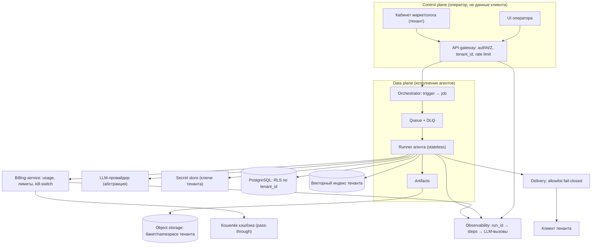
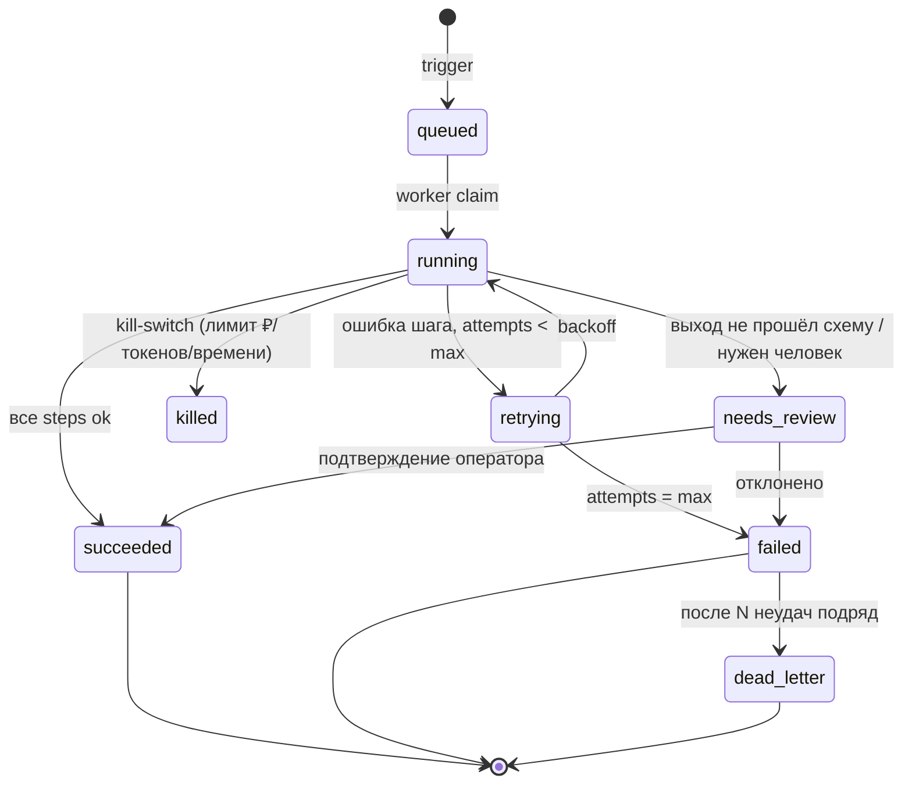
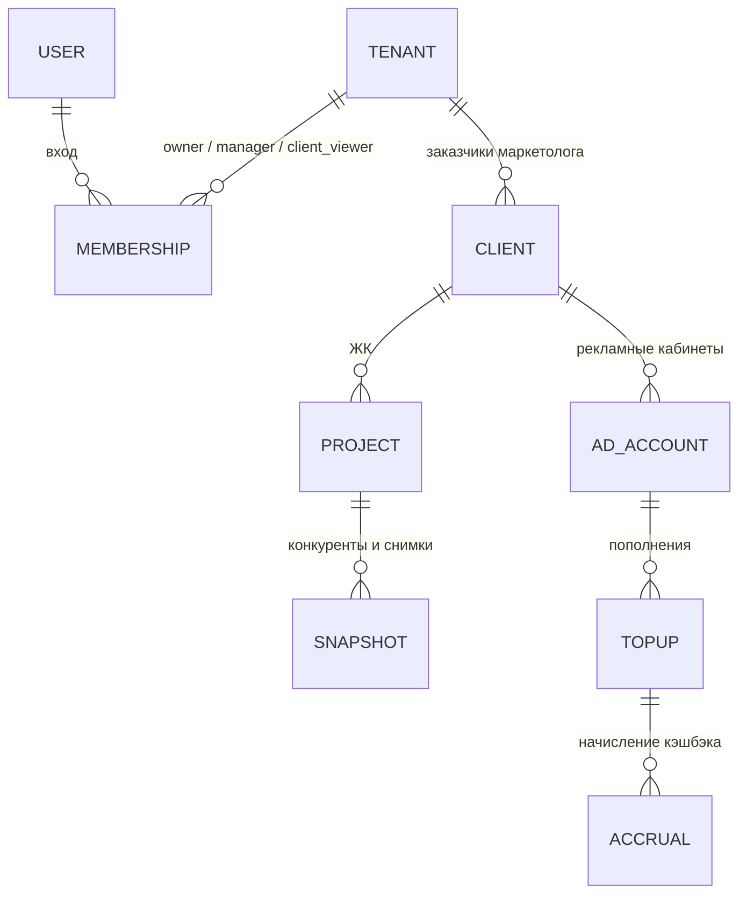
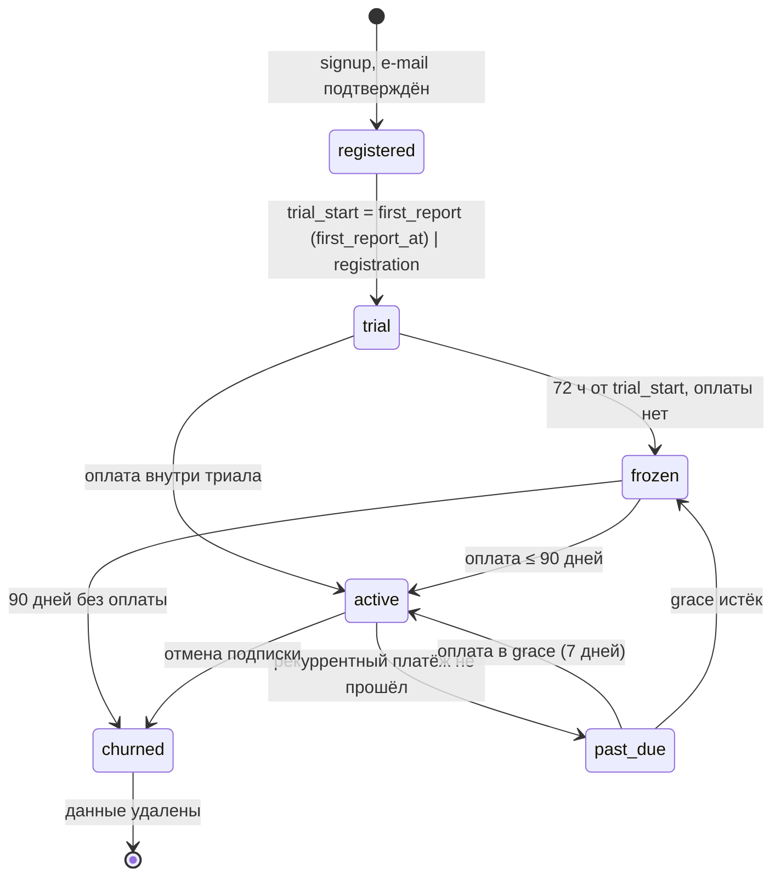

# Целевая архитектура агентной платформы (multi-tenant AI-SaaS)

Статус: blueprint для согласования. Дата: 2026-11-08. Автор: `arch` (task-2).
Дополнено 08.11.2026: `arch2` (task-9) — тенант = маркетолог, self-service/триал/заморозка, подписка, кэшбэк-контур (§3.5, §3.6, §5.2–§5.3, §5.6, §8, §9).
Границы: правки — только этот файл, остальные файлы только читались. Оценки в человеко-неделях помечены значком
**⚠ необоснованно** там, где в репозитории нет данных о скорости команды, стоимости часа и нормативах
(`audit/saas-layer.md` §8, `audit/techdebt-risks.md` «Открытые вопросы»).
Ссылки на текущее состояние: `audit/*.md §N` или `путь:строка`. Слово «оценка» ≠ факт.

---

## 0. Что есть сейчас (честная точка отсчёта)

Работает **один детерминированный конвейер** «Агент 1»: сбор лотов → снимок CSV → аналитика (медианы, Δ, выбросы) → отчёт; в прогоне 2026-11-05 у обоих клиентов есть `.md/.xlsx/.docx`, **PDF отсутствует**, а положительный путь доставки `sent` не подтверждён ни разу (`01-competitor-watch/reports/clients/client-svet/`, `.../client-granel/`; `docs/concept-saas-2026-11-04.md` §10.6). LLM в контуре **не вызывается**: grep по движку не находит ни одного вызова модели (`audit/agent-layer.md` §3; `audit/techdebt-risks.md` §5.2).

| Что | Состояние | Доказательство |
|---|---|---|
| Движок «Агент 1» | работает; 29 файлов `.py` в `01-competitor-watch/scripts/` (в аудите — «28 модулей») | перечисление каталога; `audit/agent-layer.md` §2.1 |
| Реестр агентов как контракт | декларация без схемы; `inputs/outputs` — свободные строки | `audit/agent-layer.md` §1.2 |
| Системные настройки (`schedule`, `limits`, `retries`, `timeout_sec`, `alerts`, `stop_switch`) | **не читает ни один модуль** — лимит и таймаут сработать не могут | `registry/agent-settings/agent-1-competitor-watch.yaml:19-21,26-27,53`; `audit/agent-layer.md` §1.3 |
| Триггер | задача Планировщика Windows, не связана с `agents.yaml` | `audit/agent-layer.md` §1.4 |
| Панель | небезопасный control plane: 25 маршрутов, один статический ключ, «22 маршрута пишут на диск» (из аудита; непроверяемо без трассировки вызовов) | `audit/saas-layer.md` §2.1–§2.2 |
| Мультитенантность | отсутствует: один ключ = все клиенты | `audit/saas-layer.md` §3.2 |
| Хранилище | файлы вместо БД; 486 `.bak` = 3,05 МиБ; VCS нет | `audit/techdebt-risks.md` §4.1, §4.3 |
| Метеринг | фиктивен: токены = «символы/4», выход = размер PDF/XLSX | `01-competitor-watch/scripts/collect_clients.py:468-480`; `audit/saas-layer.md` §4.2 |
| Observability | нет request id, нет журнала запросов, 3 несогласованных писателя `runs.jsonl` | `audit/saas-layer.md` §6.4; `audit/agent-layer.md` §2.7 |
| Достоверность цифр | о тестах в дереве **четыре разных числа**: 52 / 465 / 319 / 268 — основывать «работает сейчас» на них нельзя | `registry/agents.yaml:21`; `audit/techdebt-risks.md:76`; `docs/concept-saas-2026-11-04.md:42`; `docs/audit/mvp-audit-engine.md:49` |

**Горизонты (детали — §9):** работает сейчас — конвейер и отчётность (`.md/.xlsx/.docx`; PDF в прогоне 05.11 нет),
снимки; доставка настроена, но путь `sent` не подтверждён. MVP — шаг 1; после первого клиента — шаг 2; v1 — шаг 3; отложено — шаг 4.

---

## 1. Целевая схема

### 1.1 Текстовая диаграмма

```text
  КАБИНЕТ МАРКЕТОЛОГА (тенант) + CONTROL PLANE оператора (сегодня — один serve.mjs: монолит с root)
  UI тенанта: клиенты, проекты, кабинеты, прогоны, отчёты · UI оператора: тарифы, счета, кэшбэк, алерты
        │ HTTPS + сессии + RBAC
  ┌─────▼──────────────────────────────────────────────────────────────────────┐
  │ API-GATEWAY (не панель): authN/authZ, tenant_id, rate limit, CSRF, request-id│
  └──┬────────────────────────────┬────────────────────────────────────────────┘
     │                            │
  ┌──▼──────────────────┐  ┌──────▼───────────────────────────────┐
  │ ORCHESTRATOR        │  │ BILLING-SERVICE (отдельный контур)   │
  │ trigger→job→steps   │  │ usage, лимиты, overage, кошелёк      │
  └──┬──────────────────┘  │ кэшбэка (pass-through)               │
     │ job: идемпотентный  └──────┬───────────────────────────────┘
     │ ключ + DLQ                 │ сверка с внешними API
  ┌──▼────────────────┐          │
  │ QUEUE (брокер)    │──────────┘
  └──┬────────────────┘
     │ claim (visibility timeout)
  ┌──▼─────────────────────────────────────────────────────────────┐
  │ RUNNER AGENTS (data plane, stateless): контракт из реестра,    │
  │ LLM-клиент, secret store тенанта, валидация схем, kill-switch  │
  └──┬───────────┬────────────┬───────────┬───────────────────────┘
     │           │            │           │
  PostgreSQL   OBJECT       VECTOR      DELIVERY (SMTP/ESB, allowlist
  (RLS по      STORAGE      SEARCH      fail-closed, человек
  tenant_id)   (бакет       (эмбеддинги подтверждает публикацию)
               тенанта)     тенанта)
  OBSERVABILITY (сквозная): run_id → step → LLM-вызов (токены, ₽, латентность)
```

### 1.2 Mermaid



### 1.3 Что вынести из панели наружу и в каком порядке

| # | Вынести | Почему (факт) | Порядок |
|---|---|---|---|
| 1 | Запуск процессов | `execFileSync` в одном потоке: панель замирает на 180–300 с; факт 278,7 с > таймаута 180 с | **сразу** (шаг 1) |
| 2 | Права доступа | один ключ = полный доступ ко всем 25 маршрутам и всем клиентам; ключ утёк в лог | **сразу** (шаг 1) |
| 3 | Управление рантаймом DSH | панель пишет `<профиль DSH>/package.json`, `~/.dsh/dsh-delegate-router.json`, Obsidian-vault | **сразу** (шаг 1) |
| 4 | Биллинг и лимиты | лимиты объявлены, но не читаются; метеринг фиктивен | шаг 2 |
| 5 | Доставка | белый список fail-open; соединение и логин на каждого адреса | шаг 2 |
| 6 | Аналитика/отчётность | строится в браузере по 23 JSON-дампам (`dashboard/public/data/*.json`; в аудите — «24 JSON»), `tasks.json` 489 КБ | шаг 3 |

Доказательства: `dashboard/serve.mjs:21,305,1993,2010`; `audit/saas-layer.md` §2.2, §2.5, §7.

---

## 2. Оркестрация агентов

### 2.1 Реестр — единственный источник контрактов

Целевой `agents.yaml` v2: для каждого агента `contract` (JSON Schema входа/выхода), `steps[]`, `resources`
(CPU/память/браузер), `limits`, `retries`, `schedule`, `eval_ref`. Сейчас `inputs`/`outputs` — свободные строки
без валидации (`registry/agents.yaml:18-19`; `audit/agent-layer.md` §1.2), а единственный типизированный контракт
живёт в коде движка (`01-competitor-watch/scripts/cwlib.py:23-43`).

Правило: **раннер не читает YAML напрямую** — он получает контракт через API реестра (версионированный),
иначе возвращается дефект «панель показывает одно, движок читает другое» (`audit/agent-layer.md` §1.5 п.3).

### 2.2 Жизненный цикл запуска

`trigger → job → steps → artifacts → report`:

| Стадия | Содержимое | Идемпотентность |
|---|---|---|
| trigger | cron/ручной/вебхук; проверяется `enabled` и окно расписания | триггер не создаёт job, если ключ уже `succeeded` |
| job | постановка в очередь с `run_key` и дедупликацией | `UNIQUE(tenant_id, agent_id, run_key)` |
| steps | шаги контракта; каждый шаг пишет статус и артефакт | шаг перезапускаем; побочный эффект — только через idempotency-key |
| artifacts | объектное хранилище, путь `tenant/agent/run/...` | перезапись артефакта = тот же путь |
| report | отчёт + доставка | повторная доставка блокируется ключом `(run_id, recipient, template)` |

**Ключ прогона:** `run_key = hash(client_id + agent_id + period + contract_version)`. Версия контракта в ключе
обязательна: смена контракта не должна «схлопывать» новый прогон со старым.

### 2.3 State-машина



### 2.4 Ретраи

| Класс ошибки | Ретрай | Backoff | Лимит | Пример из кода |
|---|---|---|---|---|
| Сеть/источник, 5xx, таймаут | да | экспоненциальный + jitter, база 5 с, cap 10 мин | 3 попытки на шаг, `retries` из реестра | `platforms.py:599` (timeout 25 с) |
| 4xx/капча/блокировка площадки | нет | — | — | статус `needs_browser`/`needs_partnership` (`platforms.py:639-658`) |
| Ошибка LLM-провайдера | да | 2 попытки, затем fallback-модель | 1 fallback на шаг | нет в коде (`audit/techdebt-risks.md` §5.2 п.7) |
| Ошибка валидации выхода | нет | — | сразу `needs_review` | — |
| Исчерпание бюджета | нет | — | `killed` + алерт | лимиты не читаются (`audit/saas-layer.md` §4.2 п.4) |

Дедупликация ретраев: повторный запуск шага не должен повторно списывать usage — `usage_event.idempotency_key`
= `(run_id, step_id, provider_request_id)`.

### 2.5 DAG vs последовательный конвейер

| Критерий | Последовательный конвейер | DAG |
|---|---|---|
| Когда оправдан | шаги линейны, дешёвые, общий артефакт (текущий Агент 1: сбор→снимок→аналитика→отчёт) | независимые источники/ЖК/тенанты, разная длительность |
| Параллелизм | нет (`for client in clients` без нитей — `collect_clients.py:932,940`) | fan-out по клиенту/источнику, fan-in на аналитике |
| Отказоустойчивость | падение шага рвёт весь прогон (`audit/agent-layer.md` §2.5) | изоляция ветки, частичный результат |
| Когда вводить | MVP (шаг 1) | при ≥5–10 клиентах или ≥2 источниках с браузером |

Практика: MVP — последовательный конвейер, но **fan-out по клиентам на уровне job-ов** (один job = один
клиент), а не внутри процесса. Полный DAG — после первого клиента.

---

## 3. Multi-tenancy

### 3.1 Модель изоляции

Базовое правило: `tenant_id` в **каждой** таблице + Row-Level Security в PostgreSQL; отдельные namespace/бакеты
в объектном хранилище; ключи внешних API — только тенант-скоупные, в secret store, никогда в общем YAML.

Сейчас: единственная проверка — ключ, понятия «тенант» нет; подтверждение — `/api/service/run` принимает `id`
клиента из тела без проверки прав (`dashboard/serve.mjs:1865-1874`; `audit/saas-layer.md` §3.2 п.1). Общее дерево
`data/snapshots/<дата>/lots.csv` не содержит клиента в пути, а ключ лота `(source, competitor, project, lot_id)`
даёт одинаковый `lot_id` двум клиентам с одним конкурентом — «схлопывание» данных (`audit/saas-layer.md` §3.2 п.2;
`01-competitor-watch/scripts/cwlib.py:30`).

### 3.2 Уровни и пороги

| Уровень | Изоляция | Когда уместен | Цена перехода |
|---|---|---|---|
| shared (tenant_id + RLS) | логическая, одна схема | до ~20 клиентов | обязательна дисциплина `tenant_id` в каждом запросе |
| schema-per-tenant | физическая в одном кластере | 20–100 клиентов, требования договора/безопасности | миграции ×N, пул соединений |
| database/cluster-per-tenant | полная | ≥1000 клиентов, enterprise-требования | оркестрация парка, стоимость эксплуатации |

| Масштаб | Что делать | Что сломается без этого |
|---|---|---|
| 20 клиентов | shared + RLS; очередь вместо синхронных запусков; один job на клиента | последовательный сбор: 20× от 278,7 с (`registry/runs.jsonl:27`) |
| 100 клиентов | schema-per-tenant для крупных, shared для мелких; партиционирование usage; отдельный пул воркеров на браузерные задачи | rate limits площадок, фиксированные CDP-порты 9333/9344/9363/9364 (`audit/saas-layer.md` §7) |
| 1000 клиентов | cluster-per-tenant / шардирование, мультирегион, self-service онбординг | ручные правки YAML на каждого клиента (`audit/saas-layer.md` §3.3) |

### 3.3 Секреты и внешние ключи тенанта

| Артефакт | Сейчас | Целевое |
|---|---|---|
| SMTP-пароль платформы | env → файл `00-admin/config/.smtp-password.local` (`audit/saas-layer.md` §6.2) | secret store, ротация |
| Ключи источника (Serper/ReefAPI/Apify…) | `.env` (2 из 11 ключей), глобальные на весь проект | на тенанта, шифрование, аудит доступа |
| Ключ доступа панели | файл рядом с проектом, утёк в `dashboard/logs/server.out.log:9` | сессии + RBAC, ключ отозван и не логируется |
| Ключи клиента (Директ OAuth, Метрика) | отсутствуют | per-tenant, scope-минимум, TTL и refresh |

### 3.4 Запрет общего состояния

Запрещено в целевой схеме: общий YAML как правда (`registry/**` — 20 YAML-файлов, читает и панель, и движок —
`audit/techdebt-risks.md` §3.3, где указано «19 YAML»); абсолютные пути с именем пользователя (`client_report.py:29,31`,
`platforms.py:43`, `install/force-rollback.ps1:22` — `audit/techdebt-risks.md` §3.1), запись вне проекта
(`dashboard/serve.mjs:37,38`). Целевое: конфиг — из БД по `tenant_id`; пути — относительно корня арендатора
или ключа объекта в хранилище; никакой процесс не пишет вне своего namespace.

### 3.5 Модель тенанта: маркетолог → клиенты → проекты → кабинеты

Рамка 08.11.2026 — **тенант = маркетолог** (агентство, фрилансер, in-house). В реестре она объявлена, но не
исполняется: «ПЛАТФОРМА (ИП) → ОПЕРАТОР → КЛИЕНТ оператора» (`registry/operators.yaml:3-8`, связь `operator_id` в
`registry/clients.yaml:9,20,31,42`), изоляции нет — один ключ открывает всех (`audit/saas-layer.md:234-239`), а
`client_id` берётся из тела запроса (`dashboard/serve.mjs:1865-1874`). Иерархия: `tenant` → `client` (заказчик
маркетолога) → `project` (ЖК) → `ad_account` (кабинет клиента); `client` — **не** тенант, своих пользователей нет.



| Сущность | `tenant_id` | Изоляция | Сегодня → цель |
|---|---|---|---|
| clients, projects, competitors, snapshots | NOT NULL, FK на client | RLS | общий YAML и дерево снимков (`audit/saas-layer.md:240-248`) |
| ad_accounts, topups, partner_returns, accruals | NOT NULL | RLS + уникальность кабинета | YAML-демо, кода нет (§5.3) |
| runs, artifacts, usage_events, subscriptions, invoices | NOT NULL | RLS + путь `tenant/<id>/...` | общий `runs.jsonl`, счета вручную (§5.4) |

- `tenant_id` — NOT NULL в каждой таблице; RLS `USING (tenant_id = current_setting('app.tenant_id')::uuid)`; объекты — `tenant/<tenant_id>/client/<client_id>/...`; секреты — namespace тенанта.
- Кабинет «клиента маркетолога» (отложен): роль `client_viewer` + `client_scope(client_id)`, предикат `client_id IN (SELECT …)` поверх tenant-RLS; таблицы **не переделываются** — добавляются UI и claim.
- `client_id` не заменяет `tenant_id`: оба обязательны и проверяются на сервере, не в UI (defense in depth).

### 3.6 Self-service: регистрация, вход, лимиты триала, абьюз

Регистрации нет вовсе: вход — один статический ключ, ролей/сессий/подтверждения e-mail нет
(`audit/saas-layer.md:146-159`), rate limit и CSRF отсутствуют (`:175-190`); публичная форма регистрации на текущем
коде лишь расширила бы keyless-доступ с localhost (`:182-186`).

| Вариант | Что даёт | Оценка |
|---|---|---|
| hosted auth (Supabase/Auth0/Clerk) | сессии, подтверждение e-mail, OAuth, сброс, MFA, организации; Supabase ближе всех — целевая БД PostgreSQL + RLS | 3–5 чн ⚠ |
| самописный | полный контроль, ноль внешних зависимостей | 8–14 чн ⚠ |

Рекомендация — **hosted auth**: закрывает ровно то, чего нет, и не заставляет писать рассылки и сброс пароля самому.
Оценки из `docs/strategy-2026-11-08/roadmap-2-sprints.md:45` и всё равно **⚠ необоснованны**: скорости команды нет,
цена и резидентность поставщика (152-ФЗ) не проверены.
Поток: signup → подтверждение e-mail → первый вход создаёт `tenant` + `membership(owner)` → мастер «1 клиент, 1 ЖК,
≤5 конкурентов». Триал 3 дня (72 ч от `trial_start`, §5.6), лимиты (предложение, решает владелец): 1 проект, 1 прогон в сутки (≤3 за триал),
LLM-бюджет на тенант (3 000 ₽/мес объявлен, но не читается —
`registry/agent-settings/agent-1-competitor-watch.yaml:19-21`), экспорт разрешён, кэшбэк и Директ — только после
`active`. Абьюз: верификация e-mail до первого прогона, капча и rate limit по IP, один триал на
e-mail-домен/телефон/карту, LLM-бюджет с первого шага, N регистраций с одного IP/устройства → ручная проверка;
данные триала при заморозке сохраняются (§5.6).

---

## 4. Контекст и память агентов

### 4.1 Слои

| Слой | Что хранит | Где живёт | Время жизни | Пример из проекта |
|---|---|---|---|---|
| Рабочий контекст прогона | вход, промежуточные шаги, артефакты | память воркера + temp-бакет тенанта | до конца прогона | снимок CSV + payload аналитики (`audit/agent-layer.md` §2.2, §6.1) |
| Долговременная память тенанта | профиль ЖК, список конкурентов, пороги, тон отчёта | PostgreSQL (структурно) | пока активен тенант | `01-competitor-watch/config/clients/<id>.yaml` |
| Эпизодическая память | история прогонов, решений оператора, доставок, ошибок | PostgreSQL + объектное хранилище | 12–24 мес (политика) | `registry/runs.jsonl` (27 записей), `registry/results.yaml` |
| Семантический индекс | эмбеддинги описаний ЖК/промо/объяснений | векторный индекс **с фильтром по tenant_id** | пересобирается | сейчас нет (`audit/agent-layer.md` §6.2) |

### 4.2 Векторный поиск vs структурные таблицы

| Вопрос | Структурные таблицы | Векторный поиск |
|---|---|---|
| Числа, цены, дельты, квоты, лимиты | **да** — единственный источник | нет (округления и «похожесть» недопустимы) |
| «Найди похожие ЖК/промо/прошлые объяснения» | плохо | **да** |
| Идемпотентность и сверка | **да** | нет |
| Retrieval для LLM | как точный фильтр | как дополнение, **после** фильтра по `tenant_id` |

Правило: вектор — вспомогательный слой. Любая цифра в отчёте берётся из структуры, вектор даёт только текст
и подсказки.

### 4.3 Ретенция и «что нельзя в промпт»

| Данные | Срок | Обоснование |
|---|---|---|
| Логи LLM-вызовов (промпт/ответ) | 30–90 дней, затем агрегаты | стоимость хранения vs разбор инцидента |
| Usage-события | 5 лет | биллинг и сверка с внешними API |
| Снимки лотов | 24 мес | сравнение год-к-году |
| Артефакты отчётов | 24 мес | переотправка клиенту |
| PII получателей `sent_to` | на время договора | сейчас в открытом виде в `registry/results.yaml:185+` (`audit/agent-layer.md` §7.1) |

**Нельзя класть в промпт:** PII получателей и контактов (`registry/clients.yaml:10,21,32,43`), данные чужого
тенанта, суммы бюджетов и рекламных расходов клиента, содержимое `error`/`note` из внешних программ без
санитайза (`audit/agent-layer.md` §7.3 п.4), сырой HTML страниц целиком (до 3 МБ — `platforms.py:599`).
Данные чужого тенанта не должны попадать в контекст даже как «пример»: retrieval всегда с жёстким фильтром
`tenant_id = :current`.

---

## 5. Биллинг за использование

### 5.1 Метеринг событий

| Событие | Источник | Единица | Идемпотентный ключ |
|---|---|---|---|
| LLM-вызов | ответ провайдера (`usage`) | вход/выход токенов, ₽ | `(run_id, step_id, provider_request_id)` |
| Страница/источник | runner шага сбора | страница, запрос | `(run_id, step_id, url_hash)` |
| Прогон | orchestrator | прогон (job) | `(tenant_id, agent_id, run_key)` |
| Отчёт | слой артефактов | отчёт, формат | `(run_id, format, template_version)` |
| Доставка | delivery | письмо/получатель | `(run_id, recipient_hash, template_version)` |

Сегодня метеринг фиктивен: `estimate_cost(model, chars_in, chars_out)` считает токены как `символы/4`, где
`chars_out` — размер PDF/XLSX (`collect_clients.py:468-480,768-770`; `audit/saas-layer.md` §4.2 п.2), а
`/api/service/run` пишет сметную себестоимость как факт (`dashboard/serve.mjs:1882,1910`).

### 5.2 Тарифы, лимиты, overage, приём платежей

Целевая сетка (решение 08.11.2026) — **Starter / Growth / Pro**; кэшбэк только на Growth и Pro (§5.3). Это
**третья** нумерация в пакете: концепция — Lite/Pro/Agency/Enterprise (историческая справка, `docs/concept-saas-2026-11-04.md` §4), MVP-прайс —
Starter 5 000 / Growth 15 000 / Pro 30 000 (`docs/strategy-2026-11-08/README.md:59-60`), реестр — 2 900/5 900/3 900/9 900/5 900
(`registry/services.yaml:13,25,37`); расхождение зафиксировано в `README.md:26`. Цены не выдумываются — ниже механика.
Лимит проектов по тарифу проверяет billing-service **до** создания сущности: предупреждение 80 % → hard-stop
`killed` на 100 % → overage только по явному согласию. Сейчас в реестре нет ни «включено в тариф», ни цены
превышения (`audit/saas-layer.md` §4.2 п.8), `on_limit: pause` не исполняется
(`registry/agent-settings/agent-1-competitor-watch.yaml:21`). Платежи: рекуррентные списания и токенизация карты — у
провайдера (карточные данные не храним, PCI DSS вне скоупа); вебхуки идемпотентны по `provider_event_id`; апгрейд —
prorate `(new − old) × дни/30` сразу, даунгрейд — с начала следующего периода без возврата. Чек/ККТ (54-ФЗ)
**не закрыт** (`docs/strategy-2026-11-08/README.md:29`), провайдеры — только в каталоге
(`docs/integrations-catalog.md:66-67`), кода приёма платежей нет. Неоплата: retry D+1/D+3/D+7 → `past_due` (grace
7 дней, доступ сохранён) → `frozen` (§5.6). Смена тарифа/лимита — append-only событие с автором.

### 5.3 Рекламные кабинеты и кэшбэк-контур маркетолога

Кэшбэк — **pass-through**, не доход (`docs/concept-saas-2026-11-04.md` §6, §12;
`docs/strategy-2026-11-08/finmodel-blueprint.md:275`): нетто-возврат партнёра → доля маркетолога (тенанта) → маржа
платформы. Сегодня контур на бумаге: `cashback_share` = 0 вхождений в код и `registry/**`
(`docs/strategy-2026-11-08/verification.md:32` Ф9), начисления — демо (`registry/cashback.yaml:11-17`, демо-убыток
7 200 ₽ в `:30-31`); договоров нет (`docs/strategy-2026-11-08/gtm-mvp-scope.md:22,82`), OAuth-ключей Директа нет
(`audit/saas-layer.md:217`), API Директа не реализован (план — `docs/agent2-yandex-direct-plan.md:8,39`), в
`registry/integrations-catalog.yaml` Директа нет вовсе.

| Таблица | Поля (суть) | Заменяет |
|---|---|---|
| `ad_account` | `tenant_id, client_id, platform, external_id, partner, credential_ref, status` | — |
| `topup` | `ad_account_id, tenant_id, partner, amount_rub, paid_at, confirmed_at, doc` | `registry/ad-budgets.yaml:15-22` |
| `partner_return` | `ad_account_id, period, gross_return_rub, commission_pct, net_return_rub, cash_in_at` | `ad-budgets.yaml:42-48` |
| `accrual` | `tenant_id, ad_account_id, period, partner_return_id, tariff, share_pct, amount_rub, status, idempotency_key` | `registry/cashback.yaml:11-17` |
| `payout` | `tenant_id, amount_rub, subscription_credit_rub, withdrawal_rub, method, status` | `cashback.yaml:19-21` |

Расчёт: `нетто = возврат × (1 − комиссия)` при комиссии партнёра-посредника **3 %**; `кэшбэк = нетто × share`,
share = **50 % Growth / 80 % Pro**. Предохранитель: `Σ accrual ≤ net_return` в той же транзакции (deferred CHECK),
`amount ≥ 0`; при `net_return = 0` начисление не создаётся, в UI — «возврата нет» (`client-loss-demo`,
`registry/clients.yaml:29-38`). Старую базу не переносить: `cashback_pct` 4–6 % от оборота (`registry/operators.yaml:22,29,36`) и доля нетто-возврата — разные величины.
Подключение: (а) OAuth-доступ клиента к Директу (read-only scope, токен в secret store тенанта); (б) партнёрский
кабинет eLama/Vitamin как посредник. Лаг cash-in до 50 дней уже учтён как отсрочка (`registry/ad-budgets.yaml:50-53`):
`accrual` в `pending` до подтверждения отчёта → `confirmed` после сверки → `paid` после выплаты/зачёта;
`UNIQUE(ad_account_id, period, partner_return_id)` — повтор отчёта сумму не удваивает, ручная правка — отдельное
событие с автором (append-only).
Выплата кэшбэка по решению заказчика от 08.11.2026: **в MVP — только зачёт в баланс подписки** (`paid` = зачтено, вывода денег нет);
вывод СБП/на счёт ИП с актом и гибридный порог 10 000 ₽ — **шаг 2**, после 3 платящих с подключёнными кабинетами и первого
подтверждённого возврата. В обоих случаях только в состоянии `active`: в `frozen`/`past_due` — пауза без отзыва начислений.
Сверка ежемесячно: `Σ accrual` ↔ отчёт партнёра ↔
`topup`, расхождение > 0,5 % → стоп выплат и тикет. Юр-режим: `client-pays` (услуга, НПД возможен) и
`through-service` (НПД не применяется — `registry/ad-budgets.yaml:3-9`); кэшбэк — только `through-service` и при
договоре. Не смешивать с usage-биллингом: разные базы и источники истины.

### 5.4 Сверка с внешними API

Ежемесячно: сумма usage-событий ↔ счёт провайдера (токены), ↔ фактические списания источников (страницы/квоты),
↔ начисления/выплаты кэшбэка от партнёра. Сейчас сверка ручная и частичная: `verify-data.mjs` считает маржу,
но не полноту выставления счетов по активным подпискам (`audit/saas-layer.md` §4.2 п.9).

### 5.5 Что нужно до первого платящего клиента

| Обязательно до первого платежа | Можно вручную |
|---|---|
| измерение токенов провайдера (usage из ответа), не эвристика | выставление счёта и ссылка оплаты |
| лимит на прогон/тенант/день + kill-switch | сверка с провайдером (раз в месяц) |
| идемпотентная запись usage | тарифные планы сверх Starter/Growth/Pro (Enterprise, seats) |
| разложение расхода по тенанту (сейчас `usage.json` агрегирует все сессии — `audit/saas-layer.md` §4.2 п.1) | кэшбэк-контур (Growth/Pro, только после партнёрского договора — §5.3) |
| аудит-трейл изменения тарифа/лимита | налоговые и бухгалтерские проводки |

### 5.6 Жизненный цикл подписки: триал → заморозка → retention



Заморозка (`frozen`): запуск прогонов, создание проектов и кабинетов, экспорт, доставка писем, выгрузка в Директ.
Остаётся: вход, read-only отчёты и артефакты, оплата, выгрузка своих данных. `trial` — 72 ч от `trial_start`: режим
`first_report` (дефолт беты, таймер от `first_report_at`) или `registration` (A/B-переключатель); без отчёта 14 дней →
`churned`. `past_due` — grace 7 дней с полным доступом. Уведомления: T−24 ч до конца триала, T0, +3 дня, за 7 дней до
удаления (T+83), удаление (T+90). Retention 90 дней от `frozen`/`churned`, затем hard delete данных (usage — 5 лет, §4.3).
Идемпотентность: каждый переход — `subscription_event(tenant_id, kind, idempotency_key UNIQUE)`, применяется CAS по
`expected_state`; повтор не дублирует письма и начисления; sweeper раз в сутки (04:00 МСК) безопасен при повторе.
Оплата на 90-й день: подтверждена до sweep — тенант возвращается в `active` без потери данных; после — `churned` уже
применён, восстановление из снапшота 30 дней с ручным подтверждением оператора (⚠ решение владельца, не факт).

---

## 6. Observability

### 6.1 Трассировка

Сквозной `run_id` создаётся в orchestrator, передаётся в runner, в каждый LLM-вызов и в доставку:
`run_id → step_id → llm_call_id` (провайдер, модель, токены in/out, ₽, латентность, статус). Сейчас
correlation id отсутствует: `run_id` не пишется в лог и `source-runs.jsonl` (`audit/agent-layer.md` §2.7),
journal запросов панели не существует вовсе (`audit/saas-layer.md` §6.4).

### 6.2 Метрики

| Метрика | Зачем | Целевой порог (оценка, требует калибровки) |
|---|---|---|
| p50/p95 длительность прогона | SLA и планирование очереди | p95 < 15 мин на клиента |
| Стоимость на прогон (₽) и на тенанта/день | лимиты и юнит-экономика | ≤ declared `limit_rub` |
| Доля ошибок источников | качество сбора | < 20 % источников в `error` |
| Качество по eval | защита от деградации LLM | см. §7, §8 |
| Пустые отчёты | тихий отказ | 0 на клиента за неделю |
| Очередь: глубина, возраст job, DLQ | «панель мертва» → «очередь растёт» | возраст < 2× расписания |

### 6.3 Логи, алерты, аудит оператора

Логи структурированные (JSON), с `run_id`/`tenant_id`, ротация по размеру и сроку — сейчас ротации нет, лог
движка машинно нечитаем (смешаны UTF-8 и cp866 — `audit/agent-layer.md` §2.7), `.bak` не удаляются.
Алерты: превышение стоимости, провал источника, пустой отчёт, рост DLQ, отказ провайдера. Сейчас
`alerts.when`/`quiet_hours` объявлены, но потребителей нет (`audit/agent-layer.md` §1.3).
Аудит-трейл действий оператора обязателен: сегодня любой с одним ключом может править реестр, запускать
движок и откатывать `.bak` без следа (`audit/saas-layer.md` §2.2, §2.5 п.8).

---

## 7. Guardrails и безопасность

| # | Угроза | Мера | Состояние сейчас |
|---|---|---|---|
| 1 | Prompt injection из веб-страниц | контент в промпт только как данные в явном контейнере; HTML → текст, обрезка; промпт-инструкции не берутся из входных данных; LLM не имеет прав на запуск инструментов | риск нулевой: LLM не вызывается (`audit/agent-layer.md` §7.3); входы-кандидаты: `promo_text`, сырой HTML, транскрипты `registry/tasks/*.yaml` |
| 2 | Невалидный выход агента | JSON Schema на выход каждого шага; провал → `needs_review`, не публикация | нет ни схем, ни валидации (`audit/agent-layer.md` §1.2) |
| 3 | Публикация без человека | «человек подтверждает публикацию» для внешних действий (письмо, объявление, выгрузка в Директ) | автоотправка включена: `--email-mode always` (`install/agent1-weekly.cmd:24`) |
| 4 | Перерасход | лимиты на прогон/тенант/день, kill-switch, предупреждение на 80 % | лимиты не читаются (`audit/saas-layer.md` §4.2 п.4) |
| 5 | Утечка отчёта чужому | allowlist получателей **fail-closed** + ключ `(run_id, recipient)` | allowlist fail-open: нет списка → рассылка без ограничений (`audit/saas-layer.md` §7) |
| 6 | Секреты | только secret store; запрет вывода секретов в лог/ошибку | ключ панели печатается целиком в лог (`dashboard/serve.mjs:2404-2408`; `audit/saas-layer.md` §2.2) |
| 7 | PII | минимизация: адреса хэшируются в журналах и промптах; `sent_to` не в открытом виде | адреса открыто в `registry/results.yaml:185+`, `logs/agent1-weekly.log` (`audit/agent-layer.md` §7.1) |
| 8 | Смешение данных тенантов | RLS + `tenant_id` в каждом запросе; retrieval с фильтром тенанта | изоляции нет (`audit/saas-layer.md` §3.2) |
| 9 | Маркировка рекламы (ОРД/ERID) | обязательный атрибут креатива/выгрузки + журнал ERID; при проведении бюджетов — обязанность платформы, продаётся как add-on | в проекте не реализовано; требование зафиксировано `docs/agent2-yandex-direct-plan.md` этапы 1.5, 7.32 |

---

## 8. Риски мультиагентной архитектуры

Вероятность/ущерб — экспертная оценка (⚠ нет данных для численной модели: фактический расход токенов и
тарифы внешних API неизвестны — `audit/saas-layer.md` §8).

| Риск | Механика | Вероятность | Worst case | Ранний сигнал | Мера |
|---|---|---|---|---|---|
| Рост стоимости LLM при автономии | автономные агенты делают лишние шаги/ретраи; кэш промптов нет; учёта токенов нет | высокая | счёт провайдера превышает выручку тенанта в разы | ₽/прогон растёт, доля кэш-хитов падает | лимит на прогон/тенант/день + kill-switch; кэш промптов; дешёвая модель по умолчанию; метеринг из `usage` |
| Деградация качества без eval | смена модели/промпта не измеряется; «выглядит нормально» | высокая | клиент уходит после 2–3 неверных отчётов | доля отчётов, принятых без правок, падает | golden-set + eval в CI, версия промпта и контракта в `run_key`, канареечный прогон |
| Каскадные ретраи | ретрай шага × ретрай источника × ретрай провайдера → взрыв запросов и расходов | средняя | rate-limit баны площадок и 10× расход | глубина DLQ, число попыток на job | бюджет попыток на job (не на шаг), jitter, circuit breaker, DLQ |
| Vendor lock-in | площадки (`platforms.py:60-63`), DSH (`serve.mjs:34-66`), LO Kit (`client_report.py:29-31`), LLM нет вообще | высокая (уже реализована) | смена вендора = остановка продукта | рост числа площадок/моделей в коде | адаптеры источник/LLM/рендер; контейнеризация; убрать абсолютные пути (A1–A11 `audit/techdebt-risks.md` §3.1) |
| Задержки при синхронных запусках | `execFileSync` держит панель; 278,7 с > таймаута 180 с | уже наступила | обрыв прогона и «неуспех» при фактически собранных данных | таймауты в журнале прогонов | очередь + асинхронный job; идемпотентный повтор |
| Утечка данных между тенантами | один ключ, общее дерево снимков, `lot_id` без клиента, retrieval без фильтра | высокая | клиент видит данные конкурента → потеря контракта и репутации | появление `tenant_id`-пустых записей | RLS, tenant-скоупные бакеты и ключи, тесты изоляции в CI |
| Маркировка рекламы/ОРД | платформа проводит бюджеты → обязанность маркировки на ней | средняя (при запуске Агента 2) | штраф и блокировка кабинета | выгрузка в Директе без ERID | ERID-поле обязательно в креативе, журнал, предупреждение при выгрузке |
| Фиктивный метеринг как «ложные цифры» | оценка `символы/4` уходит в счета и маржу | уже наступила | клиент оспаривает счёт | расхождение сметы и `runs.jsonl` на порядки | до продаж: измерение вместо оценки; сметные цифры помечать «оценка» |
| Абьюз триала | мультиаккаунты и одноразовые e-mail гоняют отчёты бесплатно; регистрация без верификации | высокая | расход LLM на тенант растёт при нулевой выручке | рост регистраций с одного IP/домена, доля тенантов без оплаты | верификация e-mail, капча, rate limit, 1 триал на домен/карту, LLM-бюджет с первого шага (§3.6) |
| Фрод-платежи и чарджбэк | украденные карты, возвраты после получения отчёта, бюджеты клиентов в режиме `through-service` | средняя | возвраты и штрафы эквайринга, отзыв доступа | доля чарджбэков > 1 %, разные страны карт с одного IP | 3DS, холд первой выплаты, KYC при `through-service`, лимит выплаты без договора |
| Зависимость от партнёра-посредника | eLama/Vitamin меняют ставку и порог, задерживают отчёт, расторгают договор | высокая (договоров нет — `docs/strategy-2026-11-08/gtm-mvp-scope.md:82`) | кэшбэк обещан, но не фондирован → убыток и репутация | просрочка отчёта > 50 дней, изменение `commission_pct` | абстракция `partner`, ≥2 партнёра, кэшбэк не в оффере до договора (§5.3) |
| Расхождения в начислениях | двойная загрузка отчёта, ручная правка, разные базы (оборот vs нетто) | средняя | недоплата/переплата, спор с тенантом | `Σ accrual ≠ partner_return`, доля ручных корректировок | идемпотентный ключ, предохранитель `Σ ≤ net_return`, сверка > 0,5 % → стоп, append-only аудит |
| Блокировки рекламных API | OAuth отозван клиентом, 403 и лимиты Директа, смена правил площадки | высокая при росте | кабинет отключён → кэшбэк и отчёты встали | рост 401/403, отзывы токенов | read-only scope, per-tenant токены с refresh, деградация «кэшбэк приостановлен» без потери подписки |
| Утечка между клиентами одного маркетолога | RLS только по `tenant_id`: роль `client_viewer` видит весь тенант, артефакты в общем бакете | средняя | заказчик маркетолога видит ЖК и бюджеты другого заказчика | запросы `client_viewer` вне `client_scope`, `tenant_id`-пустые записи | RLS по `tenant_id` **и** `client_scope`, пути `tenant/<id>/client/<id>`, тесты изоляции в CI (§3.5) |

---

## 9. Порядок внедрения

Оценки — человеко-недели одного инженера и **все помечены ⚠ необоснованно**: в репозитории нет данных о
скорости команды, ₽/час и нормативе прогонов. Якоря (25 маршрутов панели — `audit/saas-layer.md` §2.1;
3 писателя `runs.jsonl` — `audit/agent-layer.md` §2.7; 155 КБ `serve.mjs` — `audit/techdebt-risks.md` §5.1)
описывают объём кода, но не ограничивают трудозатраты.

| Шаг | Что делаем | Оценка | Обоснованность |
|---|---|---|---|
| **1. MVP** (до первого платящего клиента) | БД (PostgreSQL) + `tenant_id`/RLS + схема тенанта (§3.5); API-gateway с сессиями и RBAC; **hosted auth и самостоятельная регистрация — 3–5**; **триал 3 дня + заморозка + retention — 1,5–2**; **подписка Starter/Growth/Pro, эквайринг, чеки/ККТ — 2–4**; вынос запуска процессов в очередь + runner; один job на клиента; измерение токенов; лимит+kill-switch; allowlist fail-closed; ключ панели отозван; минимальный аудит-трейл | 15–25 | ⚠ необоснованно: 8–14 прежней версии + 6,5–11 на self-service (оценки из `docs/strategy-2026-11-08/roadmap-2-sprints.md:45-49`); скорости команды и ₽/час по-прежнему нет. Порядок внутри шага: auth → тенант → подписка → триал/заморозка (`roadmap-2-sprints.md:56-57`) |
| **2. После первого клиента** | billing-service: лимиты/overage, идемпотентные usage-события, сверка с провайдером; подключение рекламных кабинетов (OAuth/API Директа) и кэшбэк-контур (50/80 % нетто, предохранитель, сверка, гибридная выплата) — **только после партнёрского договора**, 2–4 чн внутри шага; логи + ротация + алерты; golden-set и eval в CI; контейнеризация (A1–A11) | 6–12 (+2–4) | ⚠ необоснованно: объём кэшбэк-контура зависит от договоров; оценка 2–4 из `roadmap-2-sprints.md:48` |
| **3. v1** | schema-per-tenant и партиционирование; DAG-оркестрация и параллельные воркеры; векторная память с фильтром тенанта; **кабинет клиента маркетолога** (роль `client_viewer` + `client_scope`, витрина отчётов; модель данных уже готова — §3.5) 2–4 чн; публикация только через подтверждение человека | 12–24 | ⚠ необоснованно: нет данных о требованиях клиентов и о проде; 2–4 на кабинет — оценка без данных |
| **4. Отложить** | мультирегион/мультикластер, собственный флот парсеров вместо Chrome/CDP, публичный API для клиентов, автопостинг креативов без человека, маркетплейс скиллов | — | сознательно вне горизонта: приоритет — предсказуемость и изоляция, а не охват |

Правило приёмки каждого шага: тесты изоляции тенантов, идемпотентности прогона и kill-switch — в CI; любая цифра в интерфейсе с пометкой «оценка», если она не измерена (сейчас панель показывает сметные 120 ₽ как факт — `dashboard/serve.mjs:1882,1910`).
**Открытые вопросы без данных** (перенос из `audit/saas-layer.md` §8): тарифы Serper/ReefAPI/Apify; лимиты SMTP-провайдера; ₽/час оператора; целевой SLA прогона; где будет прод (ОС, контейнеры); политика хранения (§4.3 — предложение, не решение владельца).
